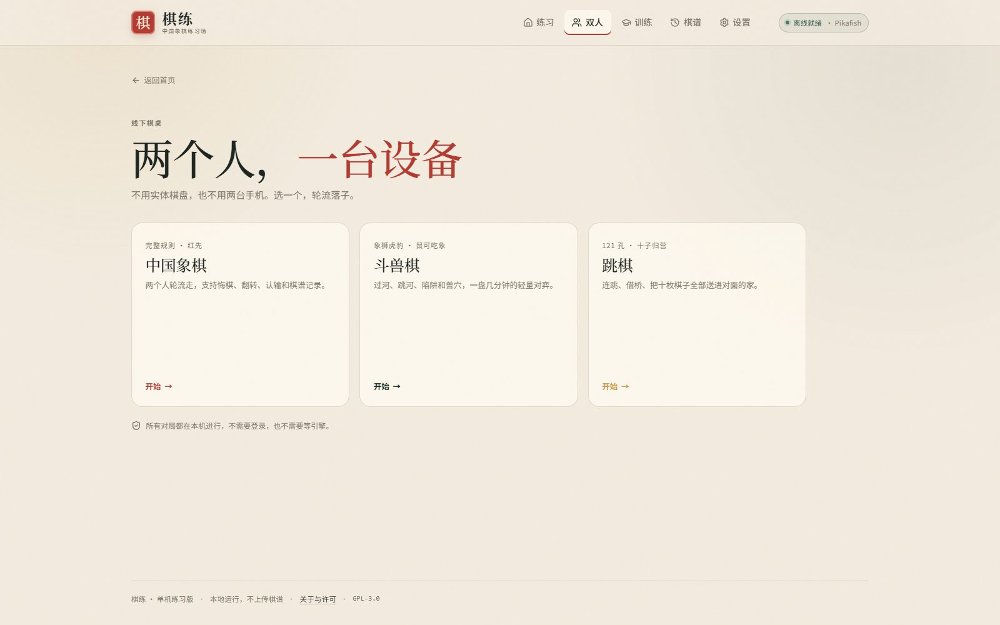
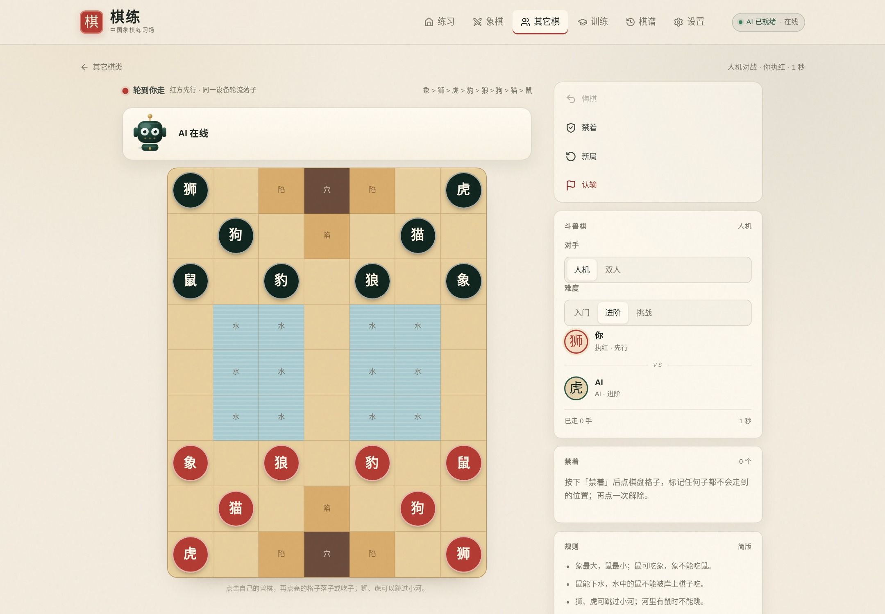
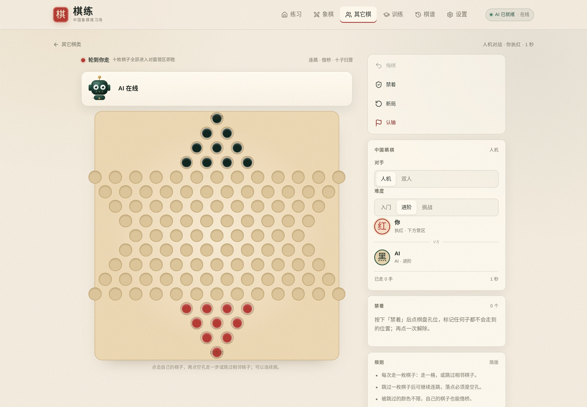
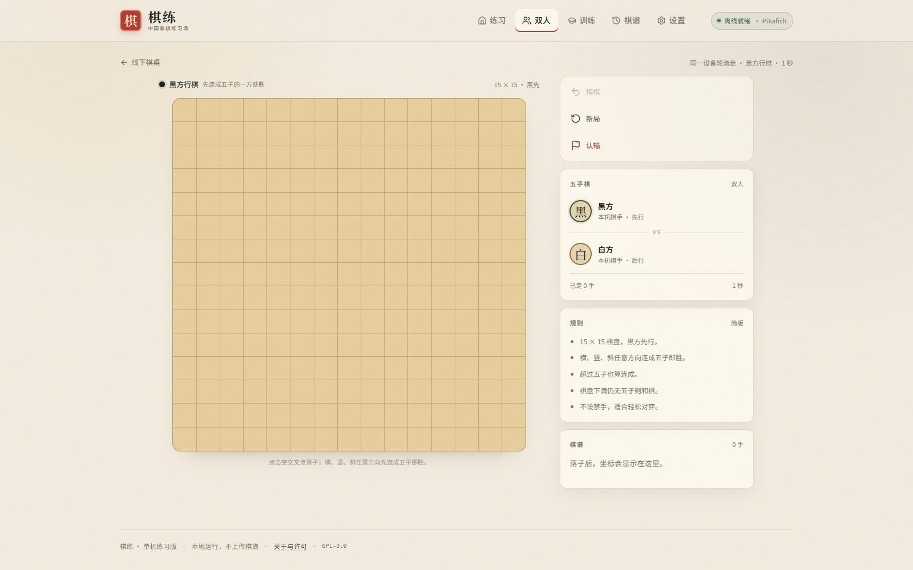
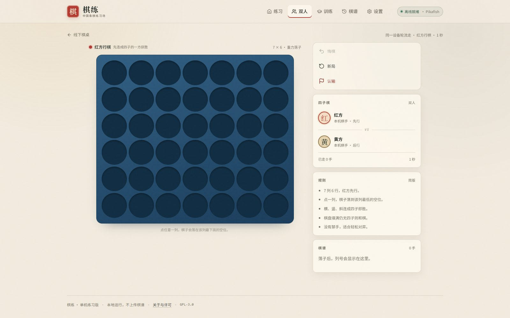
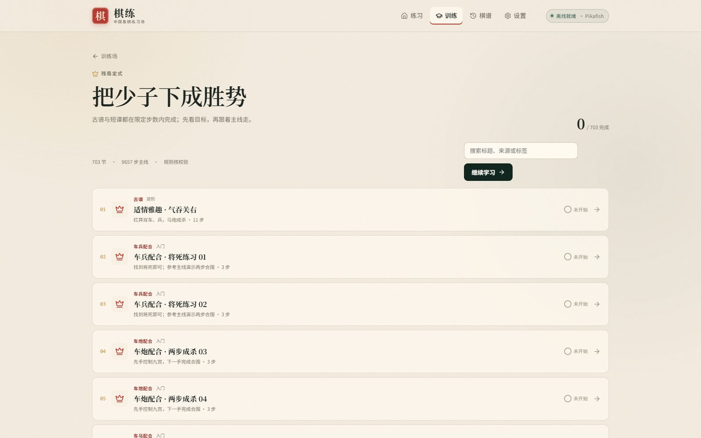
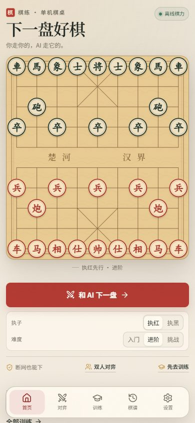

# 棋练

**一个打开就能下的中国象棋练习场。**

单机 · 离线 · 无账号 · 无广告

**[开始下棋 →](https://chuccp.github.io/chess-train/)** · **[线下棋桌 →](https://chuccp.github.io/chess-train/local)**

## 为什么做这个

想练棋的时候，经常只是想安静下几盘、做几道杀法，不想注册、不想匹配、不想被催促。

棋练把中国象棋引擎放在浏览器本地：打开就能和 Pikafish 下，也能按自己的节奏练杀法、残局和开局。两个人在一起时，还可以共用一台设备轮流下，不需要实体棋盘。

下过的棋、做过的题、走到哪一步，都只留在自己的设备里。

## 现在能练什么

| 训练 | 内容 |
|---|---:|
| 杀法 | **801** 道一步杀 |
| 残局 | **703** 节，古谱为主 |
| 开局 | **88** 套主线 |
| **合计** | **1592** 条 |

所有训练条目都标了 **入门 / 进阶 / 挑战**。刷题、跟练、随便下下，都能找到合适的难度。

## 三种练法

### 杀法：先看见，再算清

红先，一步将死。

可以自己找，也可以看提示、对答案。做错的题会留下来，方便回头再练。

### 残局：在限定步数内收口

不要求死记某一条主线。只要在限定步数内把对方将死，就算完成。

古谱残局会注明原书、局号和原谱链接；走法不唯一时，也不强制按参考线走。

### 开局：把出动顺序走顺

从常见开局和古谱主线里，理解大子怎么出、中路怎么护、车往哪里摆。

你走红方，黑方按原谱自动应手；按主线一步一步走，不会突然变成两边都由你操作。

不是背整本棋谱，而是先把前十几步的“顺序感”建立起来。

### 线下棋桌：不止中国象棋

不用实体棋盘，也不用两台手机。

棋练准备了五张线下棋桌：

- **中国象棋**：完整规则，支持悔棋、翻转、认输和棋谱记录；被将军时也可以悔棋，将死有绝杀动画，吃子有提示
- **五子棋**：15 × 15，横竖斜先连成五子
- **斗兽棋**：象狮虎豹、鼠吃象、狮虎跳河、陷阱和兽穴
- **跳棋**：121 孔、十子归营，支持连跳
- **四子棋**：7 × 6，重力落子，先连四子

它们都不调用引擎，不需要联网，两个人轮流点选棋子就能下。

| 斗兽棋 | 跳棋 |
| --- | --- |
|  |  |

| 五子棋 | 四子棋 |
| --- | --- |
|  |  |

## 它和普通象棋 App 有什么不同

- **引擎在本地**：Pikafish WebAssembly + NNUE，不把局面发到服务器
- **能离线**：第一次联网准备好引擎后，之后断网也能继续下和练
- **人机对弈**：吃子有提示，将死有绝杀动画，被将军时也可以悔棋
- **悔棋可调**：设置里开关悔棋、将军后悔棋，以及线下双人 1–10 步（默认 10 不限制）；人机对战机器最后一步自动退 2 手，自己最后一步退 1 手
- **历史棋局可续弈**：回放里点「回到对弈」，载入终局结果后按人机规则退棋：机器最后一步退 2 手，自己最后一步退 1 手
- **没有账号**：没有注册、登录、排行榜和每日任务
- **两个人也能下**：中国象棋、五子棋、斗兽棋、跳棋、四子棋，同一台设备轮流落子
- **进度在本机**：棋谱、完成记录、错题都只存在浏览器里
- **不强制唯一解**：残局只要将死即可，不因为没走“标准答案”判错
- **古谱有出处**：公版古谱保留原书、局号、来源链接；规则核逐条校验

## 内容来源

残局与杀法主要整理自：

- 《适情雅趣》
- 《橘中秘》
- 《梅花谱》
- 《吴氏梅花谱》
- 《崇本堂梅花谱》
- 《韬略元机》
- 《烂柯神机》
- 《梦入神机》
- 《心武残编》
- 《渊深海阁》
- 《竹香斋》
- 《百局象棋谱》

古谱原文属于公有领域；现代整理版的注释和棋图没有直接复制。批量导入的古谱条目会保留原谱着法和来源链接，讲解由本项目重新整理。

## 看一眼

| 残局训练库 | 手机端 |
| --- | --- |
|  |  |

## 安装到桌面或手机

棋练是 PWA，可以直接添加到主屏幕：

- **Android Chrome**：菜单 → 添加到主屏幕
- **iPhone Safari**：分享 → 添加到主屏幕
- **桌面 Chrome / Edge**：地址栏右侧的安装图标

第一次打开需要联网准备引擎资源（约 4.6 MB）。准备完成后，断网也能继续使用已经缓存的内容。

## 适合谁

- 想随时下盘棋，但不想被匹配和计时追着跑的人
- 想和朋友用一台手机、平板或电脑下象棋、五子棋、斗兽棋、跳棋或四子棋的人
- 想练杀法、残局，又不想背标准答案的人
- 喜欢古谱，想按原书线索慢慢看的人
- 手机上想找一个干净、能离线用的象棋练习场的人

## 开发与许可

棋练代码以 [GPL-3.0](LICENSE) 发布，可自由查看、修改和自部署。

- 开发、构建与部署：[docs/DEVELOPMENT.md](docs/DEVELOPMENT.md)
- 产品与技术设计：[docs/DESIGN.md](docs/DESIGN.md)
- 源码与第三方声明：[SOURCE-OFFER.md](SOURCE-OFFER.md)
- 上游项目：[github.com/chuccp/chess-train](https://github.com/chuccp/chess-train)

Pikafish 与 NNUE 权重遵循各自许可；本版本免费公开、非商业，不含广告、付费或赞助。
