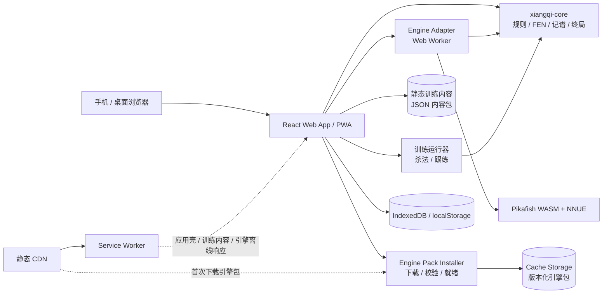

# 棋练 ChessTrain · 单机中国象棋练习设计文档

| 项目 | 内容 |
| --- | --- |
| 文档状态 | v0.6 · V1 已实现（实现说明见 README） |
| 日期 | 2026-10-20 |
| 仓库 | `chuccp/chess-train` |
| 暂定名 | 棋练（ChessTrain） |
| 产品形态 | 响应式 Web + PWA，手机、平板和桌面浏览器共用一套代码 |
| 引擎 | **Pikafish** 中国象棋引擎，单线程 WebAssembly + NNUE，在 Web Worker 中运行 |
| 分发许可 | **接入引擎后的发布版：代码 GPL-3.0**；NNUE 权重按 Pikafish NNUE-License（免费非商业）。仓库已于 2026-10-20 切换为 GPL-3.0；第三方声明和源码提供已随应用发布 |
| 已确认范围 | **只做单机练习，不做真人对局**；不做账号、联机、服务器和真人匹配 |
| 训练范围 | 人机对弈、杀法训练、残局定式训练、开局训练；本地棋谱与基础回放 |
| 文档范围 | 产品、交互、视觉、规则、训练内容、架构、授权、离线、测试与交付计划 |

> **引擎与离线结论**：V1 采用成熟高棋力的 **Pikafish**，使用单线程 WebAssembly，在本地 Web Worker 中运行。首次在线打开时必须先完成引擎包下载、哈希校验和引擎自检，界面显示“离线就绪”后，断网、关闭浏览器再打开仍可完成人机对弈。首次准备完成前不得宣称离线可用。
>
> **授权前提**：Pikafish 引擎代码为 GPL-3.0，NNUE 权重为免费非商业许可。选择它意味着**发布版整体按 GPL-3.0 分发，并且 V1 不得商业化**（广告、付费、赞助等需另行确认权重许可）。仓库 `LICENSE` 已切换为 GPL-3.0，第三方声明、源码与构建信息已随应用发布；若后续不能维持这套授权，就不能继续发布含 Pikafish 的构建。

> **定位说明**：棋练是一个打开即用的网页单机象棋练习场。玩家和本机 Pikafish 对弈，训练杀法、残局定式和开局，完成的棋局可以在本机回看。进度留在设备上；不需要注册，不等待对手，不依赖游戏服务端。首次完成离线引擎准备后可离线使用。
>
> “残局定式”和“开局”在 V1 中是**跟练式课程**：按经过校验的主线走子并阅读讲解，不用 AI 自由判断胜负。自由对练、开局记忆复习和更深入的 AI 分析放在后续版本。

**目录**

- [0. 摘要](#0-摘要)
- [1. 产品定义](#1-产品定义)
- [2. 范围与交付阶段](#2-范围与交付阶段)
- [3. 用户体验设计](#3-用户体验设计)
- [4. 视觉与交互规范](#4-视觉与交互规范)
- [5. 象棋规则与领域模型](#5-象棋规则与领域模型)
- [6. 技术设计](#6-技术设计)
- [7. 数据与存储](#7-数据与存储)
- [8. 非功能需求](#8-非功能需求)
- [9. 测试与质量](#9-测试与质量)
- [10. 开发里程碑](#10-开发里程碑)
- [11. 风险与应对](#11-风险与应对)
- [12. 待确认决策](#12-待确认决策)
- [附录](#附录-a--术语)

---

## 0. 摘要

棋练围绕一条主线设计：**和 AI 对弈，再加上三类可以反复训练的基本功。**

五个核心能力：

1. **人机练习**：三档难度，选择执红或执黑，支持悔棋、提示、认输和新局。
2. **杀法训练**：短小将死题，练计算和常见杀法；作答即验证，提供提示和讲解。
3. **残局定式训练**：精选残局局面，跟练必胜、巧胜或守和的关键手法，配要点讲解。
4. **开局训练**：按开局系统跟练主线与常见变化，理解每步目的，而不是背孤立着法。
5. **本地回看**：完成的对局自动保存，可逐手前进、后退和跳转；V1 不做引擎分析。

所有内容通过静态资源下发；首次完成引擎准备后可离线使用，进度保存在本机。

**关键决策**

- **Web/PWA 优先**：一套响应式代码覆盖手机和桌面，可添加到主屏幕；不做原生 App。
- **成熟引擎优先**：采用 Pikafish，而不是自研搜索；单线程 WASM 在 Web Worker 中运行，避免 SharedArrayBuffer 和 COOP/COEP 门槛。
- **引擎随应用离线**：首次在线打开时下载并校验约 5–10MB 的引擎包（JS + WASM + NNUE），写入版本化缓存；只有引擎自检通过后才显示“离线就绪”。
- **纯单机**：没有后端、账号、云同步、排行榜、好友房和真人匹配。除静态资源与可选的匿名统计外，不发送用户数据。
- **授权随引擎确定**：应用发布版按 GPL-3.0 分发；NNUE 权重按 Pikafish NNUE-License 仅作免费非商业使用；发布物必须附源码获取方式、许可证和校验信息。
- **规则核心自研**：独立 TypeScript 包，负责走法、终局、FEN 和记谱；不依赖 UI 或浏览器存储；引擎返回的着法必须经规则核心校验。
- **训练内容与对弈分离**：杀法题是可判定的解题；残局定式和开局是带讲解的跟练课程。V1 不让 AI 临时评判定式/开局走向。
- **本地优先**：IndexedDB 保存当前对局、历史、训练进度和练习统计；Cache Storage 保存引擎包；清除浏览器数据等于清除进度和离线能力。
- **回放先行**：V1 的棋谱回放只读、本地；引擎分析是 V1.1 的叠加能力，不阻塞基础回看。

---

## 1. 产品定义

### 1.1 背景与问题

很多象棋网页产品把对弈、社交、赛事和广告揉在一起。只想安静练棋的人会面对：

- 需要注册、下载或等待真人对手。
- 首屏信息过多，找不到“直接开始”。
- 手机棋盘过小、按钮拥挤，横屏不可用。
- 新手没有安全的练习环境：不能悔棋、没有提示、难度不合理。
- 想系统练杀法、残局定式或开局时，内容往往是零散题目或长篇视频，缺少能动手跟练、能保存进度的课程。
- 练棋进度依赖账号或网络，换环境就丢。

棋练反其道而行：打开即下，练三类基本功，不被打扰。

### 1.2 产品定位

> **打开就能下一盘、练一项基本功的单机象棋练习场。**

关键词：单机、安静、低门槛、手机优先、可离线、可跟练。

练习闭环：

```text
进入首页 → 和 AI 下棋 / 进入训练中心选一项
→ 完成一局、解出一道杀法或跟练一课 → 看讲解、保存进度 → 回看棋谱、下一项或休息
```

### 1.3 目标用户

| 用户 | 典型需求 | 使用场景 | 产品提供的价值 |
| --- | --- | --- | --- |
| 入门学习者 | 刚会走子，怕下错、怕被虐 | 通勤、睡前、碎片时间 | 三档 AI、悔棋、基础杀法、开局第一课 |
| 休闲棋友 | 想快速来一盘，不想注册或等人 | 手机浏览器、工作间隙 | 一键开局、无需登录、自动保存、离线可玩 |
| 训练型棋友 | 想练杀法、定式和开局套路 | 固定练习时段 | 三类结构化训练、讲解、完成记录与复习入口 |

V1 三类用户都能使用；完整复盘、自由定式对练、间隔复习和大规模内容库放在后续单机增强中。

### 1.4 产品目标与约束

**目标**

- 首次在线打开后 **30 秒内完成引擎准备并显示“离线就绪”**（目标网络；实际以 5–10MB 包体和设备性能为准）。
- 离线就绪后，重新打开到完成第一步棋 ≤ 30 秒。
- 断网、关闭浏览器再打开后，仍能启动并完成人机对弈；不能出现只缓存了页面、引擎却不可用的情况。
- 一局练习能完整走完；规则判定、悔棋、提示、保存都可靠。
- 三类训练都有首课/首题可以立即开始，且进度可见。
- 完成对局后能从本地棋谱中重新打开并逐手回看。
- 手机和桌面体验一致，不需要放大页面或横向滚动。
- 单机能力完整，不依赖任何游戏服务端。

**明确不做的功能**

- 真人对战：在线匹配、好友房、本地双人、观战、聊天和锦标赛。
- 账号、云同步、排行榜、段位和成就体系。
- 自建服务器、数据库、WebSocket、服务端引擎或任何游戏业务 API。
- 原生 iOS/Android 上架包和推送通知。
- 完整开局数据库/开局树检索、残局库查询和自动生成课程。
- V1 的引擎分析、准确率报告、棋谱导入和分享。
- 非将死类战术题（捉双、牵制、闪击、抽将、弃子攻杀）及其“得子/胜势”判定；V1 杀法题目标固定为将死。
- V1 的商业化运营（广告、付费课程、赞助等）；NNUE 权重许可要求非商业使用，商业化需另行获得授权或更换权重。
- 揭棋、翻翻棋等变体，自由摆棋编辑器。

**产品约束**

- 发布性质：**免费公开、非商业**；应用代码 GPL-3.0，NNUE 权重遵循 Pikafish NNUE-License。
- 数据只存在当前设备；清理浏览器数据会丢失进度、棋谱和离线引擎，需要重新下载。
- 离线人机对弈依赖浏览器支持 Service Worker、Cache Storage、WebAssembly 和 Web Worker；不支持的浏览器只能在线使用训练内容，不能承诺离线 AI。
- 首次加载必须在线完成引擎包准备；未完成前不显示“离线就绪”。
- 无真人对手，因此没有计时器和竞技公平性问题。
- 单机定位不排斥以后增加**离线**学习功能，但不把联机功能重新带回来。

### 1.5 设计原则

1. **单机优先。** 每个核心流程都必须在断网时走通，不能把关键能力藏在网络请求后面。
2. **离线状态显式。** 未完成引擎包下载、校验和自检时，不显示“离线就绪”；失败可重试，不静默降级。
3. **成熟引擎优先。** 人机练习使用 Pikafish；不自研搜索算法，也不以弱引擎替代“高棋力”承诺。
4. **棋盘是主角。** 页面装饰让位于棋盘；一屏内优先保证棋子清晰、可点。
5. **一键开局。** 使用上次的执子与难度直接开始，设置放在二级入口。
6. **练习不惩罚。** 允许悔棋、提示和重试；不用排名或连续签到制造压力。
7. **渐进披露。** 新手只看到核心操作；棋谱、设置和讲解按需展开。
8. **同一套规则。** 人机对弈、杀法验证、定式/开局跟练和未来复盘使用同一个规则包；引擎着法必须经规则核心校验。
9. **可访问性是基本功能。** 不依赖颜色传达状态，键盘可以完成整局。
10. **明确本地属性。** 不误导用户以为进度会自动上云。

### 1.6 成功指标

**北极星指标**：每周完成的有效练习单元数（完整人机对局 + 解出的杀法题 + 完成的定式课程 + 完成的开局课程）。

| 指标 | 定义 | V1 目标 |
| --- | --- | --- |
| 激活率 | 完成过引擎准备的用户中，完成第一次合法落子或第一道训练步骤的比例 | ≥ 60% |
| 会话完成率 | 开始一局/一题/一课后完成的比例 | ≥ 40% |
| 首次落子时间 | 离线就绪后，从打开页面到第一次合法落子 | 中位数 ≤ 30 秒 |
| 离线准备时间 | 首次在线打开到“离线就绪”（含引擎包下载、校验和自检） | 目标网络下 p95 ≤ 30 秒 |
| 训练入口触达 | 首次访问中至少打开一个训练类别 | ≥ 35% |
| AI 响应 | 进阶难度从轮到 AI 到落子的 p95 | ≤ 1.5 秒 |
| 稳定性 | 无未捕获错误的会话比例 | ≥ 99.5% |
| 性能 | 中端手机 4G 下 LCP（应用壳，不含引擎包） | ≤ 2.5 秒 |
| 引擎包成功率 | 首次准备完成率；中断后可恢复 | ≥ 95%（测试环境） |
| 留存（观察） | 首次访问后的回访比例 | D1 ≥ 25%，D7 ≥ 15% |

说明：

- 激活率、训练入口触达和会话完成率可以通过本地事件或可用性测试验证。
- D1/D7 需要匿名客户端统计；V1 不强制接第三方统计，因此**不把留存作为上线验收门槛**。若产品决定公开运营并接入统计，再按真实数据评估。
- 所有指标都不能以收集棋谱内容、账号或精确位置为代价。
- “离线准备时间”以目标网络和具体引擎版本实测为准，不能用实验室本机数据代替。

---

## 2. 范围与交付阶段

### 2.1 前提假设

1. “手机和网页”指同一个响应式站点在手机、平板和桌面浏览器可用，并支持添加到主屏幕；不做两套原生 App。
2. 只有单机玩法，不做真人对战；没有账号和游戏服务端。
3. 引擎采用 Pikafish，首次在线打开时下载到本机缓存；之后断网可启动人机对弈。
4. 发布性质为免费公开、非商业；应用代码整体按 GPL-3.0 分发，NNUE 权重遵循 Pikafish NNUE-License。
5. 仓库 `LICENSE` 已切换为 GPL-3.0；Pikafish/NNUE 第三方声明和源码提供已随应用发布。
6. 界面先做简体中文，但文案集中管理，为后续 i18n 留空间。
7. 游戏进度、棋谱和引擎包默认保存在当前设备；清除浏览器数据会丢失。
8. 主要用户可能在网络条件一般、使用微信内置浏览器或低端安卓机上；离线 AI 要求浏览器支持 Service Worker、Cache Storage、WebAssembly 和 Worker。

### 2.2 版本范围

| 能力 | V1 首发单机版 | V1.1 后续单机增强 | 长期不做 |
| --- | --- | --- | --- |
| 人机对弈（三档） | ✅ Pikafish | 更多难度/让子 | 服务端引擎 |
| 离线引擎准备与管理 | ✅ 下载、哈希校验、自检、版本化缓存 | 更小包体、后台更新 | 云端引擎 |
| 悔棋 / 提示 / 认输 | ✅ | 引擎分析与推荐着法 | — |
| 杀法训练 | ✅ 20–30 题 | 更多主题和题包 | — |
| 残局定式训练 | ✅ 6–10 课（跟练） | 自由对练、更多定式 | 残局库查询 |
| 开局训练 | ✅ 3–5 课（跟练） | 记忆测验、间隔复习 | 完整开局数据库 |
| 训练进度与恢复 | ✅ | 数据导出/导入 | 云同步 |
| 本地棋谱与基础回放 | ✅ 最近 50 局，只读回放 | 回放叠加离线分析、标注和导出 | 在线分析 |
| PWA / 离线 | ✅ 应用壳 + 引擎 + 内容全缓存 | 离线内容包 | 服务端离线 |
| 响应式与可访问性 | ✅ 基础完整 | 持续完善 | — |
| 棋谱 AI 分析 / 错题本 | — | ✅ | 在线分析 |
| 引擎授权与源码提供 | ✅ GPL-3.0 + 第三方声明 + 源码获取 | 随版本更新维护 | 闭源/商业分发 |
| 深色模式 | — | ✅ | — |
| 账号 / 登录 | — | — | ✅ 不做 |
| 真人对战 / 匹配 / 好友房 | — | — | ✅ 不做 |
| 排行榜 / 段位 | — | — | ✅ 不做 |
| 商业运营 / 广告 | — | — | ✅ 不做（NNUE 未授权商业） |
| 原生应用 | — | — | 暂不做 |

### 2.3 V1 验收标准

**引擎与授权**

- [ ] 使用固定版本的 Pikafish 单线程 WASM 与匹配的 NNUE 权重；引擎 `id name` 与 About 页展示的版本一致。
- [ ] 首次在线打开时自动下载引擎包；界面显示下载进度、已下载/总大小和当前阶段（下载/校验/初始化）。
- [ ] 下载完成后逐个校验 SHA-256/字节数，并在 Worker 内完成 UCI 握手和一次冒烟搜索。
- [ ] 只有“引擎包缓存完成 + 哈希校验通过 + 冒烟搜索成功”三项都满足，才显示“离线就绪”；失败显示可重试错误，不允许把半成品标为就绪。
- [ ] 引擎包传输目标 ≤ 10MB、缓存占用 ≤ 15MB；超过硬上限则发布门禁失败，必须先优化包体。
- [ ] 在 ≥10Mbps 网络和目标中端手机上，首次打开到“离线就绪”的 p95 ≤ 30 秒（以实测记录为准）。
- [ ] 全新浏览器配置：首次在线打开并显示“离线就绪”→断网→关闭浏览器→重新打开→可启动并完成整局人机对弈。
- [ ] 离线状态下刷新页面、继续未完成对局、从本地棋谱回放均正常；引擎不发起任何网络请求。
- [ ] 下载中断、缓存缺失、资源哈希不匹配或缓存被清空时，“离线就绪”失效并给出重新下载入口，不能白屏或假装可用。
- [ ] 三档难度均能返回合法着法；挑战档使用不限制强度的 Pikafish，入门/进阶档通过 UCI LimitStrength/Elo 或 Skill Level 限制，并经实际对局校准。
- [ ] AI 思考可取消、可超时兜底；过期 `bestmove` 不得落到新局；进阶档响应 p95 ≤ 1.5 秒，挑战档 ≤ 2.5 秒。
- [ ] 离线冷启动到棋盘可操作 ≤ 3 秒；从本机缓存启动引擎到可发起 AI 对局 ≤ 2 秒（目标中端机）。
- [ ] 发布物包含 GPL-3.0 许可证、Pikafish 版权/源码获取说明、NNUE-License 和引擎包 SHA-256；源码获取地址可访问。
- [x] `LICENSE` 已从 Apache-2.0 切换为 GPL-3.0；第三方声明和源码提供已列入发布物。
- [ ] V1 不包含广告、付费、赞助或其他商业使用；NNUE 的非商业限制有明确说明。

**对局**

- [ ] 选择红/黑任意一方，完成一整局人机对弈；AI 不会走非法着法。
- [ ] 玩家执黑时，AI 自动先走，棋盘和轮次显示正确。
- [ ] 正确识别将军、将死、困毙、三次重复局面和棋、60 回合自然限着（连续 120 手无吃子）。
- [ ] 悔棋、提示、认输、新局行为明确，不产生状态错乱或“AI 抢走两步”。
- [ ] AI 思考时棋盘输入锁定、不会重复提交落子；导航、返回和取消当前搜索仍可用。

**训练**

- [ ] 从首页可进入杀法训练、残局定式训练和开局训练，三类内容的进度都可持久化。
- [ ] 杀法训练至少 20 题，可判定将死、接受合法等价将死、支持提示和讲解。
- [ ] 残局定式训练至少 6 课，按经过校验的主线跟练；走错不改变棋盘并给出提示。
- [ ] 开局训练至少 3 课，支持主线/常见变化的跟练、逐步讲解和完成记录。
- [ ] 所有训练内容都有来源/许可证和人工核验记录，并通过规则核心的合法性校验；单条内容损坏时隔离该条并提示“内容已更新”。
- [ ] 训练完成页能显示本次用时、提示次数和错误次数，数据可持久化。

**棋谱与恢复**

- [ ] 刷新或重新打开页面后可以恢复未完成的对局和训练步骤。
- [ ] 完成的对局可以从本地棋谱重新打开，并能逐手前进、后退、跳转；回放局面与保存记录一致。
- [ ] 本地棋谱、训练进度和引擎就绪状态在应用更新后仍能正确迁移或明确失效。

**跨端、性能与无障碍**

- [ ] 在 320px、390px、844×390（横屏）、768px、1440px 宽度下无横向滚动、无关键控件遮挡；旋转或改变窗口大小后击点仍准确。
- [ ] 仅用键盘可完成对局与跟练中的选子、走子、悔棋、提示、重来和关闭弹层，也可在回放中前进/后退；核心状态有屏幕阅读器播报。
- [ ] 移动端 Lighthouse 性能分数 ≥ 90（不含首次引擎包下载）。
- [ ] 规则核心、引擎适配、训练内容和关键流程均有自动化测试。
- [ ] 部署到公开预览地址，README 包含本地运行、构建和引擎资源说明。

---

## 3. 用户体验设计

### 3.1 页面地图

| 路由 | 页面 | 说明 | 阶段 |
| --- | --- | --- | --- |
| `/` | 首页 | 开始对弈、继续上局、训练入口、练习摘要 | V1 |
| `/play` | 人机对局 | 新局设置 + 棋盘对局；当前对局从本地恢复 | V1 |
| `/train` | 训练中心 | 杀法、残局定式、开局三类训练的入口与进度 | V1 |
| `/train/tactics` | 杀法列表 | 主题、难度、完成状态筛选 | V1 |
| `/train/tactics/:id` | 杀法练习 | 解题、提示、重置、讲解 | V1 |
| `/train/endgames` | 残局定式列表 | 分类、难度、完成状态筛选 | V1 |
| `/train/endgames/:id` | 残局定式跟练 | 要点讲解、主线跟练、完成总结 | V1 |
| `/train/openings` | 开局列表 | 开局系统、执子方、完成状态 | V1 |
| `/train/openings/:id` | 开局跟练 | 主线/变化、逐步讲解、完成记录 | V1 |
| `/history` | 本地棋谱 | 最近对局、结果与着数 | V1 |
| `/review/:gameId` | 基础回放 | 只读棋盘、逐步前进/后退/跳转；AI 分析为 V1.1 | V1 |
| `/settings` | 设置 | 音效、震动、棋盘方向、引擎缓存、数据清除 | V1 |
| `/about` | 关于与许可 | 引擎版本、GPL/NNUE 许可、源码获取、第三方声明 | V1 |

V1 中设置可以是独立页或弹层；如果使用弹层，仍要保证刷新后状态可恢复。没有登录页，也不存在“我的账号”。

### 3.2 首次访问路径

```text
打开页面
  ├─ 立即注册 Service Worker，开始准备离线资源
  │   └─ 下载 Pikafish 引擎包 → 校验哈希 → Worker 自检 → 显示“离线就绪”
  │       ├─ 准备期间：可浏览首页和训练内容；AI 开局按钮显示进度并禁用
  │       └─ 准备失败：显示重试，不标记离线可用
  ├─ 首页立即呈现“和 AI 下一盘”（仅在离线就绪后可用）
  │   ├─ 直接点击 → 用默认执红 + 入门难度开局（已记住上次选择则沿用）
  │   └─ 点击“设置对手” → 选执子 / 难度 → 开始
  └─ 或者从“训练中心”选择一题/一课
      └─ 第一次选中棋子时显示一次提示：“点选棋子，再点落点”
```

原则：

- 不在首页强制教程、通知授权或安装提示。
- 新用户默认“执红 + 入门”，减少第一次就被击败的挫败感。
- 第一次走子后不再重复教学提示。
- AI 执红时自动翻转棋盘，让玩家的棋子在下方；用户可以在设置中改为“始终红方在下”。
- 首次准备失败可以重试；在“离线就绪”前不宣称 AI 可离线，也不把错误伪装成 AI 思考。
- 引擎只从本机缓存加载；AI 对弈开始后不依赖网络。
- 首页把三类训练作为并列入口，不用“刷完所有题”这类强迫式文案。

### 3.3 人机练习

**引擎准备**

首次打开或缓存失效时，页面顶部/首页显示“离线棋力准备中”：

- 状态顺序：`检查缓存 → 下载 → 哈希校验 → 引擎初始化/冒烟搜索 → 离线就绪`。
- 显示已下载/总大小、速度、当前状态和重试；不伪造进度。
- 未就绪时“开始对弈”按钮禁用并解释原因；训练内容与棋谱仍可浏览。
- 准备完成后显示“离线就绪”，可断网开局；设置页可查看引擎版本、包大小、缓存状态和许可证。
- 下载失败、空间不足、校验失败、Service Worker 不可用均有独立错误，不把“离线可用”当默认。

**难度与引擎参数**

三档难度由 Pikafish 的强度限制和时间预算共同控制。V1 先采用以下配置，最终值在 M0 用真实对局校准：

| 档位 | UCI 强度限制 | 搜索预算 | Hash | 适合人群 |
| --- | --- | --- | --- | --- |
| 入门 | `UCI_LimitStrength=true`，`UCI_Elo=1280`（最低档） | `movetime 200–300ms` | 16–32MB | 刚会规则 |
| 进阶 | `UCI_LimitStrength=true`，`UCI_Elo≈1800`（以校准为准） | `movetime 500–700ms` | 32MB | 休闲棋友 |
| 挑战 | `UCI_LimitStrength=false`，不限制强度 | `movetime 1000–1500ms` | 32–64MB | 有基础棋友 |

- Pikafish 支持 `Skill Level`（0–20）和 `UCI_LimitStrength`+`UCI_Elo`（1280–3133）。如果所选 Web 构建的选项行为与文档不一致，必须在 M0 记录并校准，不能静默使用固定深度冒充难度。
- “入门/进阶”尽量通过引擎自带的强度限制实现，不自行篡改搜索算法；如最低档仍明显强于目标用户，V1.1 再研究让子或更多档位。
- 引擎始终以单线程运行（`Threads=1`），避免 SharedArrayBuffer 和 COOP/COEP 要求；这足以满足练习响应目标。
- UCI 选项基线：`Threads=1`、`Hash=32`、`Ponder=false`、`MultiPV=1`；`Sixty Move Rule=true`、`Rule60MaxPly=120`。`Repetition Rule` 必须在 M0 与本地三次重复规则对齐或设为不裁决，不能让引擎按另一套棋规故意变着。
- 玩家可选红/黑，默认红；难度和执子选择会被记住。
- **玩家执黑时，AI 自动先走**并翻转棋盘。新局、刷新恢复和“再来一盘”都必须重新遵守这条规则。
- 对局中提供“换边”：立即改执另一色，当前局面、棋谱和用时原样保留，不重开、不会把旧局存成“未完成”。换边后轮到 AI 时立即开始思考（执黑且 AI 尚未走第一手时 AI 直接先走），轮到玩家时交还操作；棋盘按“自动”方向让玩家棋子位于下方。终局后按钮禁用，换边开新局请走“再来一盘 / 调整对手”。
- 无计时器，不做读秒和超时判负；专注练习。
- 辅助：
  - **悔棋**：AI 已应招时撤销一整回合；AI 正在思考时撤销玩家刚走的一步并取消搜索。玩家执黑且 AI 尚未走第一手时，没有可撤销的玩家着法，按钮禁用。
  - **提示**：用 Pikafish 做一次更高预算的搜索，给出推荐着法/箭头，不自动落子；V1 不限次数，但记录使用次数，不展示评估分。
  - **认输**：二次确认后结束，并记录结果。
  - **新局**：有走子时二次确认；无走子直接重置。
- AI 思考时禁止玩家走子；显示“思考中”，允许通过“悔棋”或“新局”取消当前请求。
- 引擎返回的着法必须解析、校验并通过规则核心后才能落子；引擎异常时提供重试/悔棋/新局，不能卡死输入。
- 对局结束后展示结果弹层：胜方、原因、着数、练习用时和“再来一盘 / 返回首页”。
- 不展示引擎评估分数，避免把练习变成看分数。

**首次就绪后的离线行为**

- 对局页面只从本机缓存加载引擎；断网时不影响开局、悔棋、提示和 AI 应招。
- 训练内容、棋谱、字体等也在首次准备时缓存；离线刷新后可继续。
- 引擎缓存被清空或浏览器回收存储后，首页立即显示“离线未就绪”，不能继续假装可离线对弈；有网时重新下载，无网时保留可用的训练内容。

### 3.4 训练中心与三类训练

训练中心 `/train` 用三张并列入口卡组织内容：

| 入口 | 一句话 | 交互模型 | V1 内容量 |
| --- | --- | --- | --- |
| 杀法训练 | 用最短的线把对方将死 | 自由解题，规则判定 | 20–30 题 |
| 残局定式训练 | 跟练必胜、巧胜或守和的关键手法 | 带讲解的跟练主线 | 6–10 课 |
| 开局训练 | 学会一套开局的主线和常见变化 | 带讲解的跟练主线 | 3–5 课 |

共同规则：

- 每张卡片显示已完成数、总数、上次进度和“继续”。
- 按难度、主题和完成状态筛选；不设排行榜、不掉段、不强制连续打卡。
- V1 训练不计时；只被动记录练习用时，不显示倒计时，也不把速度作为排名依据。重点是理解与走对。
- 完成页和题目/课程卡片可显示用时、提示次数和错误次数，帮助用户回看练习情况。
- 三类训练共用棋盘、落子交互、本地保存和完成反馈；差异在判定方式与讲解面板。
- 默认把玩家的行棋方显示在下方；如果用户固定“红方在下”，则遵循该设置。
- 所有训练在断网时可继续；内容随应用静态下发。
- 训练页明确标注“杀法”或“跟练”，人机练习页标注“自由对弈”，避免用户把课程主线误当成 AI 的实时判断。

#### 杀法训练

- 题目由 FEN、行棋方、杀法主题和完整解线组成，目标固定为“将死”。
- 主题示例：双车错、马后炮、重炮、卧槽马、铁门栓。题目名称和主题由内容编辑确定。
- 作答规则：
  - 玩家走对 → 保留该步，短暂停顿后自动走出预置的对手应手。
  - 玩家走错 → 不改变棋盘，显示“再想想”，累计错误次数。
  - 玩家若直接走出未预录但同样立即将死的着法 → 直接成功。
  - 提示 → 高亮当前正确着法；不自动走子。
  - 重置本题 → 回到题面并清空本次作答进度，保留历史完成状态。
  - 查看答案 → 二次确认后播放完整主线；本题标记为“已看答案”，不计入“独立解出”，完成状态单独记录。
- 对手应手来自题目的经过校验的主线，不由 AI 临场生成；这样题目结果可复现。
- 成功页给出 1–3 句讲解：关键杀法、为什么对手无法防守，以及“下一题”。
- 进度至少记录：未开始/进行中/已完成、是否独立解出、错误次数、提示次数、本次练习用时、最近练习时间。
- 内容要求：局面合法、每条主线合法、每条线以玩家着法收尾并将死、来源/许可证可追溯。

#### 残局定式训练

- V1 是**跟练式定式课**，不是自由残局对练。课程开头说明局面、目标（如“胜”“和”）和关键手法。
- 每课由以下部分组成：
  1. 课前一页：局面、目标、局面特点和一句话思路。
  2. 跟练主线：玩家执固定一方，按课程逐手走子；对手应手自动播放。
  3. 要点讲解：关键步显示解释，如“先控制肋门，再进兵”。
  4. 完成页：复述 2–4 个要点，显示本次用时、提示和错误次数，记录“完成跟练”。
- 玩家必须走出当前主线允许的着法；走错不改变棋盘，提示“本课主线不包含这一步”，并高亮正确着法供选择。
- 每课支持“提示 / 重来 / 回看讲解”，不把提示次数或错误次数作为排名依据。
- 完成判定是走完一条经过校验的主线并到达课程终点，不宣称“已经证明必胜/守和”，也不让本地 AI 临时判定课程结果。
- “目标”字段（胜/和）用于课程分类和讲解，不用于自由对局的胜负裁决。
- 内容要求：局面合法、主线合法、双方走子交替正确、关键结论有可追溯来源；收尾局面必须有明确的教学意义。
- 分类建议：车类、马炮类、兵类、仕相防守；具体条目须先核对理论和来源，再进入首批内容。
- 自由对练、引擎防守和胜负判定放在 V1.1 设计，不在 V1 用模糊的“胜势”判定。

#### 开局训练

- 课程按开局系统组织，V1 首批建议覆盖中炮、屏风马、顺炮、仙人指路或飞相局中的 3–5 个系统；具体首批阵容待内容评审。
- 每课包含：开局目标、每步意图、主线、1–2 条常见变化和完成总结。
- 课首页列出主线和变化，用户选择一条后开始；一次只跟练一条线路，避免在一个页面里动态分叉。
- 玩家按课程指定执红或执黑，从课程起始局面开始跟练；如果开局课由对方先走，应用自动播放对方着法直到轮到玩家。对手着法由课程主线提供。
- 玩家可以自由落子，不提示偏离；只要在课程限定步数内形成将死即完成。步数用完仍未将死才显示失败，本次不计完成；点“重来”可重新挑战。
- 课程可以接受多条合法主线；完成状态按已走通的分支记录。残局目标为“将死”时，不要求严格按主线步数，任何形成将死的着法都立即完成本关。
- V1 不做开局树检索、引擎评分或“最佳着法”承诺；这是经过编辑的课程，不是开局数据库。
- 完成页展示此开局的计划与下一步学习建议，可标记“已完成”；V1.1 再增加记忆测验和间隔复习。
- 内容要求：主线合法、执子方明确、每条分支完整；讲解为原创，棋谱来源和许可证可追溯，不直接复制教材或他人课程文案。

#### 三类内容共同要求

- 每题/每课有稳定 `id`、类型、标题、难度、主题、来源、许可证和 `contentVersion`。
- 训练内容只使用规则核心校验；不存在“训练服务端”。
- 内容升级后旧进度保留；删除或重命名内容必须有迁移策略。
- 错误操作不得改变棋盘，除非明确设计为“试走”；试走状态必须有清晰返回路径。
- 课程完成只代表“完成本次跟练”，不伪造胜率、段位或能力证明。

### 3.5 本地棋谱与基础回放

- 正常结束、认输，或在有走子时确认新局/结束当前对局后，把摘要和完整着法写入 `gameHistory`：日期、执子、AI 难度、结果（含“未完成”）、结束原因、着数、练习用时。
- `/history` 展示最近 50 局，可按结果/难度筛选；当前未完成对局不在这里，而是在首页“继续上局”。
- 打开 `/review/:gameId` 进入只读回放：
  - 从初始 FEN + 着法重建局面，不依赖保存每一帧渲染状态。
  - 支持前进、后退、跳到开局/末尾和点击着法跳转。
  - 显示结果、结束原因和着法列表（中文记谱 + UCCI 提示）。
  - 棋盘只读，不能落子；手机使用底部按钮，桌面支持左右方向键（不拦截输入框）。
- V1 不做引擎评估、失误标记、分享或导出；这些放在 V1.1。
- 单局可以删除，`设置`提供“清空本地棋谱”；两者都要二次确认。
- 记录损坏或版本不兼容时，隔离该局并提示，不影响其他记录和训练进度。
- 回放数据必须与规则核心可重放：加载时重放全部着法并核对记录结果。将死/困毙/和棋必须与盘面一致；认输或未完成局不要求盘面终局，但仍要校验每一步合法。
- 回放不重新运行 AI，也不改变已保存的结果。

### 3.6 后续单机增强（V1.1）

- **复盘增强**：在现有回放上叠加离线引擎评估、推荐着法和明显失误标记。
- **残局自由对练**：从定式局面开始与本地 AI 对练，使用真实终局结果判定；仍不依赖网络。
- **开局记忆与复习**：遮住下一步做回忆、错题复习和间隔重复。
- **更多训练内容**：新增杀法题包、定式课和开局课；可离线下载内容包。
- **错题本与数据导出/导入**。
- **深色模式**。
- 这些功能不得改变 V1 的单机边界；不引入账号、真人匹配或业务服务端。

### 3.7 对局、训练与回放交互规格

**对局**

| 事件 | 行为 |
| --- | --- |
| 点击己方棋子 | 选中，棋子轻抬；显示所有合法落点（空格圆点、可吃子圆环） |
| 点击另一枚己方棋子 | 切换到新棋子 |
| 点击合法落点 | 落子、播放 160ms 位移动画和轻音效、切换轮次 |
| 点击非法落点 | 不改变棋局；保留选中，显示短提示“这步走不了”；可选轻微震动 |
| 再次点击已选棋子 / 空白 | 取消选中 |
| 点击对方回合的棋子 | 不响应落子；状态栏提示“轮到红方” |
| 将军 | 将帅外圈标记 + 状态栏“将军！”；不打断操作 |
| 将死 / 困毙 | 结果弹层，说明“将死”或“无子可动，困毙” |
| 重复局面 / 自然限着 | 结果弹层，说明和棋原因 |
| AI 思考 | 棋盘输入锁定；显示“AI 思考中”；最短展示 300ms，避免闪动；返回、悔棋、新局可用 |
| 悔棋 | 清理当前选中、提示和搜索，回退到正确回合 |
| 刷新 / 返回首页 | 自动保存快照；首页显示“继续上局” |
| 新局 / 认输 | 二次确认；确认后保存旧局历史并重置 |

**杀法训练**

| 事件 | 行为 |
| --- | --- |
| 玩家走出解线中的正确着法 | 落子并自动播放对手应手；进入下一步 |
| 玩家走出立即将死但未预录的着法 | 直接成功，避免把等价杀法判错 |
| 玩家走错 | 不改变棋盘，显示“再想想”并计数 |
| 提示 | 高亮当前正确着法；标记录入提示次数 |
| 查看答案 | 二次确认后播放主线；记录“已看答案” |
| 刷新 / 离开 | 保存到当前步骤，下次继续 |

**残局定式训练 / 开局训练（跟练）**

| 事件 | 行为 |
| --- | --- |
| 进入课程 | 先展示目标、局面特点和关键思路，再进入棋盘 |
| 课程起始轮到对方（如执黑的开局课） | 自动播放对方着法，输入锁定，直到轮到玩家；刷新恢复后同样处理 |
| 玩家走出允许的着法 | 落子；短暂停顿后自动播放课程应手 |
| 玩家走出课程主线的着法 | 正常落子，不提示偏离；继续自由走子，步数用完仍未将死才提示失败 |
| 提示 | 高亮当前主线的正确着法，不自动走子 |
| 重来 | 回到课程起点；保留已完成记录，本次进度重置 |
| 回看讲解 | 展开当前步骤的要点或课前一页，不离开棋盘 |
| 完成一条主线 | 标记完成、展示总结；可“再练一次”或“下一课” |
| 刷新 / 离开 | 保存当前课程步骤与已完成分支 |

**本地回放**

| 事件 | 行为 |
| --- | --- |
| 从 `/history` 打开一局 | 加载初始 FEN + 全部着法，默认停在终局 |
| 前进 / 后退 | 每次移动一个半回合；棋盘和着法高亮同步 |
| 跳到开局 / 末尾 | 立刻定位；不改变已保存的对局结果 |
| 点击着法列表中的一手 | 跳到该手完成后的局面 |
| 在回放棋盘上点击 | 不落子，仅允许选中查看；不进入编辑状态 |
| 删除本地棋谱 | 二次确认；只删除该记录，不影响训练进度 |
| 记录损坏 | 显示“这局棋谱无法回放”，其他记录仍可打开 |

**移动端手势**

- 单击选中/落子为主；V1 不做拖拽，避免与页面滚动和轻点命中冲突。
- 棋盘和按钮使用 `touch-action: manipulation` 消除双击缩放误触，但不禁止页面双指缩放。
- 遵守 `env(safe-area-inset-*)`，操作栏避开底部 Home Indicator。
- 棋盘容器不拦截页面纵向滚动；用户在棋盘上轻点时不要触发意外滚动。

**键盘操作**

- `Tab` 进入棋盘；方向键在 90 个交叉点间移动焦点。
- `Enter` / `Space` 选中或落子；`Esc` 取消选中/关闭弹层。
- 快捷键（不拦截输入框）：`U` 悔棋，`H` 提示，`N` 新局，`?` 帮助。
- 训练中的“重来”“提示”“上一步讲解”都必须是可聚焦的按钮，并标明快捷键。
- 焦点样式必须明显，不能依赖 hover。

**状态与竞态**

- AI 搜索请求带 `requestId` 和局面哈希；过期响应必须丢弃。
- 悔棋、重开、切换页面时主动取消当前搜索；不能出现旧 AI 着法落到新局。
- 结果判定由规则核心完成，UI 不自行推断。
- 只有 `phase === 'playing'` 且轮到玩家时才接受走子。
- 玩家执黑时，初始化阶段直接进入 `ai_thinking`，由 AI 走第一手。
- 杀法题和跟练课程不调用 AI 搜索；对手着法来自静态主线，避免同一课程因设备不同而出现不同结果。

### 3.8 关键界面线框

**首页（手机，宽 390px）**

```text
┌────────────────────────────────┐
│ 棋练                        ⋯   │
│                                │
│ 下一盘，随时开始。              │
│ [ 和 AI 下一盘  → ]            │
│ 离线就绪 · Pikafish            │
│ 执红 · 入门 ⌄   （设置对手）    │
│ 继续上局 · 红方 · 第 18 手      │
│                                │
│ 训练中心                        │
│ [杀法 3/24] [定式 1/8] [开局 0/3]│
│ 继续跟练 · 单车类定式   →       │
│                                │
│ 本周 5 局 · 完成 8 个训练       │
│ 查看本地棋谱              →    │
│                                │
│ [练习]   [训练]   [棋谱]   [设置] │
└────────────────────────────────┘
```

**首次准备离线引擎（手机）**

```text
┌────────────────────────────────┐
│ 棋练                        ⋯   │
│ 正在准备离线棋力                │
│ 下载引擎包   ███████░░░  48%   │
│ 4.2 / 8.6 MB · 校验后即可断网   │
│ [先去训练]            [重试]   │
│                                │
│ 说明：首次需要网络；准备完成后  │
│ 关闭浏览器再断网也能对弈。      │
└────────────────────────────────┘
```

**训练中心（手机）**

```text
┌────────────────────────────────┐
│ ‹ 首页        训练中心          │
│                                │
│ 杀法训练                3 / 24 │
│ 练计算和常见杀法        →       │
│                                │
│ 残局定式训练            1 / 8  │
│ 跟练关键手法            →       │
│                                │
│ 开局训练                0 / 3  │
│ 学主线和常见变化        →       │
│                                │
│ 最近：单车类定式 · 第 6 步      │
└────────────────────────────────┘
```

**跟练课程（手机）**

```text
┌────────────────────────────────┐
│ ‹ 返回     残局定式 · 单车类    │
│ 目标：胜 · 第 6 / 12 步        │
│ ┌────────────────────────────┐ │
│ │                            │ │
│ │         （棋盘）            │ │
│ │                            │ │
│ └────────────────────────────┘ │
│ 当前讲解：先控制肋门…           │
│ [提示]     [重来]     [讲解]   │
└────────────────────────────────┘
```

**本地棋谱与回放（手机）**

```text
┌────────────────────────────────┐
│ ‹ 返回     本地棋谱      [清空]│
│ 10月20日 · 进阶 · 你执红 · 胜  │
│ 10月19日 · 入门 · 你执黑 · 和  │
│                                │
│ —— 或打开回放 ——                │
│ ‹ 返回     对局回放            │
│ ┌────────────────────────────┐ │
│ │         （只读棋盘）        │ │
│ └────────────────────────────┘ │
│ [⏮] [◀]  第 12 / 38 手  [▶]  │
│ 着法列表：炮二平五 …            │
└────────────────────────────────┘
```

**对局页（手机，竖屏）**

```text
┌────────────────────────────────┐
│ ‹ 返回     人机练习 · 进阶   ⋯ │
│ 你执红                  AI 黑  │
│ ┌────────────────────────────┐ │
│ │                            │ │
│ │         楚河   汉界         │ │
│ │                            │ │
│ │         （9×10 棋盘）       │ │
│ │                            │ │
│ └────────────────────────────┘ │
│ 轮到你走                        │
│ [悔棋]  [提示]  [新局]  [认输] │
│ 着法  1. 炮二平五 马8进7   ⌄   │
└────────────────────────────────┘
```

**对局页（桌面，≥ 1024px）**

```text
┌─────────────────────────────────────────────────────┐
│ 棋练                    练习   训练   棋谱   设置   │
├──────────────────────────────┬──────────────────────┤
│                              │ 人机练习 · 进阶       │
│                              │ 你执红 · 第 12 手     │
│          棋盘区域             │ 轮到你走              │
│                              │ [悔棋] [提示] [认输]  │
│                              │                      │
│                              │ 着法记录              │
│                              │ 1. 炮二平五 马8进7    │
│                              │ ...                  │
└──────────────────────────────┴──────────────────────┘
```

**布局规则**

- 手机竖屏：单列，棋盘尽量占满可用宽度，操作栏紧贴棋盘下方，着法列表折叠为底部抽屉。
- 手机横屏（低高度）：左右两栏，左棋盘右操作；顶部压缩为一行，着法默认折叠。
- 平板/桌面：双栏，棋盘最大约 640px，右侧信息栏 320–360px；页面最大宽度 1200px。
- 训练中心在桌面用三列卡片；手机用纵向列表，每张卡片保留“继续”按钮。
- 跟练课程在桌面采用“棋盘 + 讲解栏”；手机把讲解放在棋盘下方，使用可展开面板，不遮挡落点。
- 回放页复用对局页的棋盘与信息栏布局，但棋盘只读；手机的控制条固定在棋盘下方，着法列表可折叠。
- 当可视高度不足时，优先保证状态和操作栏，不强行塞入完整着法列表。
- 对局和课程中不显示底部导航，避免误触离局；返回时自动保存。

### 3.9 文案与错误状态

语气：克制、友好、具体，不使用嘲讽和过多感叹号。

| 场景 | 文案 |
| --- | --- |
| 玩家回合 | 轮到你走 |
| AI 回合 | AI 正在想… |
| 将军 | 将军！ |
| 非法落点 | 这步走不了，试试高亮的位置 |
| 将死结束 | 红方胜 · 将死 |
| 困毙结束 | 黑方胜 · 无子可动（困毙） |
| 重复局面 | 和棋 · 三次重复局面 |
| 杀法走错 | 再想想，注意对方的应手 |
| 跟练偏离主线 | 当前着法保留，可自由走子；步数用完后才提示挑战失败 |
| 跟练完成 | 完成跟练 · 记住这几个要点 |
| 开局完成 | 完成本开局主线 · 可以再练一次或换个变化 |
| 离线 | 已离线，仍可继续练习 |
| 离线引擎准备中 | 正在准备离线棋力：48% · 校验完成后即可断网对弈 |
| 离线就绪 | 离线就绪 · 引擎 xxx |
| 离线准备失败 | 离线引擎没有准备好，请重试或检查网络 |
| 离线缓存损坏 | 引擎文件校验失败，需要重新下载 |
| 存储空间不足 | 设备存储空间不足，无法缓存离线引擎 |
| 浏览器不支持离线 AI | 此浏览器不支持离线引擎，仍可在线使用训练内容 |
| AI 出错 | AI 这一步没有算出来，可以重试或悔棋 |
| 引擎加载失败 | 引擎无法初始化，请重试；训练内容仍可使用 |
| 训练内容加载失败 | 这一课暂时打不开，其他题目和课程不受影响 |
| 本地棋谱为空 | 完成一盘棋后，棋谱会出现在这里 |
| 回放记录损坏 | 这局棋谱无法回放，其他记录仍在 |
| 本地数据损坏 | 无法恢复上一局，其他练习进度已保留 |
| 本地进度说明 | 进度仅保存在此设备，清理浏览器数据会丢失 |

错误必须可恢复：提供“重试 / 后悔一步 / 开始新局 / 返回首页”，训练场景提供“重试 / 查看提示 / 重来”，不能只显示错误码。

---

## 4. 视觉与交互规范

### 4.1 视觉方向

**现代东方、棋盘优先、安静克制。**

- 以暖纸色、墨色、朱砂红为主，不堆砌龙纹、云纹和强木纹。
- 棋子像实体棋子，但采用干净的矢量圆片与书法感字体，不使用位图贴图。
- 棋盘线清晰、低噪点；楚河汉界文字作为唯一明显的装饰元素。
- 动效短、轻，不使用彩带、金币、夸张弹跳；这是练习工具，不是赌场。
- 深色模式不在 V1 范围，但颜色全部 token 化，便于 V1.1 增加。

### 4.2 设计 token

| Token | 值 | 用途 |
| --- | --- | --- |
| `--bg` | `#F6F0E4` | 页面底色（暖纸色） |
| `--surface` | `#FFFBF2` | 卡片、弹层 |
| `--ink` | `#1F2A2C` | 主文字、黑方棋子字 |
| `--muted` | `#5F6A67` | 次要文字 |
| `--vermilion` | `#B23A2B` | 红方棋子、主操作、品牌强调 |
| `--vermilion-strong` | `#8E2A1E` | 按压态、深色强调 |
| `--board` | `#E8C98F` | 棋盘木色 |
| `--board-line` | `#7B5537` | 棋盘线 |
| `--gold` | `#A9772A` | 选中环、提示箭头等非文本装饰 |
| `--success` | `#3D7255` | 成功、已完成 |
| `--danger` | `#A33128` | 危险操作、错误 |
| `--focus` | `#1F6F78` | 键盘焦点环 |
| `--radius-sm / md / lg` | `8px / 12px / 20px` | 控件、卡片、弹层 |
| `--space-1..8` | `4, 8, 12, 16, 24, 32, 48, 64px` | 间距体系 |
| 阴影 | `0 8px 24px rgb(31 42 44 / 0.12)` | 棋子、弹层，克制使用 |

对比度要求：正文和关键操作达到 WCAG AA；朱砂色不用于长正文。提示、选中、将军等状态不能只靠颜色区分，必须配合圆环、图标或文字。

### 4.3 字体与棋子

- UI 字体：`system-ui, -apple-system, "PingFang SC", "Microsoft YaHei", sans-serif`。
- 棋子字形：自托管 `Noto Serif SC` 子集（仅包含棋子字符），`font-display: swap`，附 OFL 许可证；加载失败时回退到系统宋体/衬线字体。
- 正文字号：移动端不小于 16px；辅助文字不小于 13px，并避免放大页面时被裁切。
- 棋子字符映射：

| 角色 | 红方 | 黑方 |
| --- | --- | --- |
| 将/帅 | 帅 | 将 |
| 士/仕 | 仕 | 士 |
| 象/相 | 相 | 象 |
| 马 | 马 | 馬 |
| 车 | 车 | 車 |
| 炮 | 炮 | 砲 |
| 兵/卒 | 兵 | 卒 |

- 红方使用简体字形，黑方使用传统异体字形（馬/車/砲），让红黑不只靠颜色区分；字体子集需包含两种字形。
- 棋子直径约为棋格宽度的 0.84–0.88，保留触控间距和选中环空间；双层细圈 + 轻微底阴影形成实体感。
- 红方与黑方同时依靠颜色 + 字符差异区分，色盲用户仍可辨认。
- 棋盘线、九宫斜线、炮兵位小十字标记必须清晰；河界文字不可影响棋子可读性。

### 4.4 尺寸与响应式

| 场景 | 布局策略 |
| --- | --- |
| 320–479px | 单列；页面左右各 12px；棋盘占满宽度；操作按钮图标 + 短文字；着法列表折叠 |
| 480–959px | 单列；棋盘最大 520px；操作栏一行；着法列表可展开 |
| ≥ 960px | 双栏；棋盘与信息栏并排；页面最大宽度 1200px |
| 横屏且高度 < 560px | 双栏优先；棋盘按高度约束；隐藏装饰标题，保留状态和操作 |
| 安全区 | 顶部/底部使用 `env(safe-area-inset-*)`；使用 `dvh` 而非 `100vh` |

- 棋盘根据容器计算尺寸，保持 9:10 的宽高比（含棋子外沿留白）；使用 SVG `viewBox`，保证任意 DPI 清晰，不拉伸棋子或棋格。
- 用 `ResizeObserver` 监听棋盘容器，在窗口缩放、屏幕旋转、地址栏高度变化后重算棋格和 90 个按钮的命中区；不缓存像素坐标。
- 坐标显示、棋子定位、触摸命中检测都使用同一套逻辑坐标；按钮用百分比定位，随棋盘一起缩放。
- 操作按钮最小触控尺寸 44×44px；棋盘单元格在 320px 屏上约 32–34px，使用整格作为命中区，并在真实设备上验证误触率。
- 桌面常见窗口高度下，对局页棋盘与控制应完整可见，避免页面整体滚动干扰落子。
- 手机端固定操作区域不能遮住棋盘底部棋子。

### 4.5 动效、声音与触感

- 棋子移动：160ms `ease-out` 平移 + 轻微落子缩放；支持 `prefers-reduced-motion` 时只淡入。
- 弹层：桌面 180ms 淡入/上移 8px，移动端底部抽屉 220ms；关闭可立即完成。
- 提示箭头：淡入 120ms，不做无限呼吸动画。
- 音效：单一木质落子声，默认开启但只在用户首次交互后初始化；可在设置中关闭。将军、胜利可有轻提示音，不播放背景音乐。
- 震动：Android 支持时，落子 10ms、错误 20ms；iOS 无标准能力时静默降级，设置中可关闭。
- AI 思考动画使用三个点或静态文字，不阻塞主线程，不因动画降低棋盘帧率。

### 4.6 可访问性

- 棋盘视觉层为 `aria-hidden` 的 SVG；上方覆盖 90 个真正的 `<button>`，按行列定位，带明确 `aria-label`（如“红方车，九路，底线”）。
- 使用 roving tabindex：整张棋盘只占一个 Tab 位，进入后用方向键移动焦点；按钮激活仍交给 `Enter`/`Space`。
- 棋盘容器使用合适的 `group`/`grid` 语义；状态区 `aria-live="polite"` 播报“红方选中车”“黑方马走到八路”“将军”。
- 仅用键盘可完成整局、一课和回放导航；焦点不会因 AI 落子或重渲染丢失。
- 回放的前进/后退/跳转使用可聚焦按钮，桌面支持左右方向键，并向屏幕阅读器播报当前手数。
- 着法列表是可读的文本替代；屏幕阅读器用户可以不依赖空间棋盘。
- 弹层焦点锁定，关闭后焦点归位；禁止仅靠 hover 展示关键信息。
- 引擎准备使用可读的 `progressbar`/状态文本，`aria-live` 只在阶段变化或失败时播报，不逐字节刷屏。
- 屏幕阅读器能获知“离线就绪”、下载失败、重试和引擎版本；演练/对局中的状态变化不被下载进度打断。
- 尊重减少动效、系统字体缩放和屏幕方向；不锁定横竖屏。
- V1 手动测试 VoiceOver（iOS）和 TalkBack（Android）的基础流程。

---

## 5. 象棋规则与领域模型

### 5.1 坐标约定

必须从第一行代码起统一，避免“红黑视角混用”这一类高频 bug。

- 内部棋盘 9 列 × 10 行，共 90 个交叉点；`Square = rank * 9 + file`，范围 0–89。
- `file = 0..8` 对应 `a..i`，从**红方视角从左到右**。
- `rank = 0..9`，`0` 是红方底线，`9` 是黑方底线。
- 因此红帅初始在 `e0`，黑将在 `e9`；UCCI 记法直接使用 `fileChar + rank`。
- 中国象棋传统记谱的红黑路数各自从本方右侧数起：红方一路在 `i` 列，黑方一路在 `a` 列。转换必须基于行棋方，不能直接复用。
- FEN 的行序与内部 rank 相反：FEN 第一行对应内部 `rank 9`，最后一行对应 `rank 0`。

示例：

| 记法 | 含义 |
| --- | --- |
| `h2e2` | 红炮二平五（红方右炮平中） |
| `h9g7` | 黑马 8 进 7 |
| 初始 FEN | `rnbakabnr/9/1c5c1/p1p1p1p1p/9/9/P1P1P1P1P/1C5C1/9/RNBAKABNR w - - 0 1` |

### 5.2 核心类型

```ts
export type Color = 'r' | 'b';
export type PieceType = 'K' | 'A' | 'B' | 'N' | 'R' | 'C' | 'P';

/** 0..89 = rank * 9 + file，rank 0 为红方底线 */
export type Square = number;

export interface Piece {
  id: string;        // 仅 UI 用于稳定渲染与动画
  color: Color;
  type: PieceType;
}

export interface Position {
  board: (Piece | null)[]; // length 90
  turn: Color;
  halfmoveClock: number;   // 无吃子手数
  fullmove: number;        // 从 1 开始，黑方走完后 +1
}

export interface Move {
  from: Square;
  to: Square;
  piece: PieceType;
  captured: PieceType | null;
}

export type BoardEnd =
  | { status: 'playing' }
  | { status: 'win'; winner: Color; reason: 'checkmate' | 'stalemate' }
  | { status: 'draw'; reason: 'repetition' | 'no-capture' | 'bare-kings' };

/** 规则核心只判定盘面结果；认输由对局控制层补充 */
export type GameEnd =
  | BoardEnd
  | { status: 'win'; winner: Color; reason: 'resign' };

export interface GameContext {
  /** 按落子顺序记录的局面哈希，含初始局面；用于三次重复判和 */
  positionHashes: string[];
}

export type MoveResult =
  | { ok: true; position: Position; move: Move; notation: string; givesCheck: boolean }
  | { ok: false; code: 'ILLEGAL_MOVE'; message: string };
```

规则包暴露纯函数：

```ts
parseFen(fen): Position
toFen(position): string
generateLegalMoves(position): Move[]
applyMove(position, move): MoveResult
evaluateBoard(position, context: GameContext): BoardEnd
isInCheck(position, color): boolean
hashPosition(position): string
```

约束：

- `applyMove` 不修改入参；非法走法返回 `{ ok:false }`，不进入“半合法”状态。
- 每步先检查轮次、起点棋子颜色和合法着法，再应用；所有外部入口必须使用合法着法。
- 走子后检查对方是否被将死或无子可动；必须能识别“吃掉将帅”这类非法输入并拒绝。
- 三次重复依赖 `GameContext.positionHashes`，不能只靠当前 `Position`。`Position` 只描述当前盘面；对局控制层每走一步追加一次哈希，恢复对局时可由初始 FEN + 着法重放重建。
- `hashPosition` 只取盘面、行棋方等重复判定所需信息，不能包含 `Piece.id` 等渲染字段。
- `GameContext.positionHashes` 的最后一个元素必须对应当前局面；不一致时返回数据错误，不静默判和。
- `evaluateBoard` 只判定盘面结果；认输由对局控制层写入 `GameEnd`。
- 规则包不依赖 DOM、React 或浏览器存储，可在 Node.js 中运行和测试。

### 5.3 走子规则

| 棋子 | 走法 | 限制 |
| --- | --- | --- |
| 帅/将 K | 上下左右一格 | 只能在九宫内：红 `d0–f2`，黑 `d7–f9`；不能与对方将帅同列无遮挡（照面） |
| 仕/士 A | 斜走一格 | 只能在九宫内 |
| 相/象 B | 斜走两格 | 不能过河；象眼（中点）被占时不能走 |
| 马 N | 日字 | 马腿（长方向相邻点）被占时不能走 |
| 车 R | 横竖任意格 | 路径上不能有棋子 |
| 炮 C | 横竖任意格 | 不吃子时路径必须为空；吃子时中间必须有且仅有一个炮架 |
| 兵/卒 P | 向前一格 | 过河后可以左右一格，永远不能后退；红向前为 rank+1，黑向前为 rank-1 |

特殊规则：

- 任何走法都不能让自己的将帅处于被将军状态，也不能形成将帅照面。
- 将帅照面本身视为“将帅互相攻击”，是走法合法性的一部分。
- 象棋不存在王车易位、吃过路兵、升变。

### 5.4 终局与判和

V1 采用明确的**休闲练习规则档**，并在帮助页/规则页说明。长期不做长将长捉的竞赛裁决。

| 情况 | 判定 |
| --- | --- |
| 被将军且无合法着法 | 将死，对方胜 |
| 未被将军但无合法着法 | 困毙，对方胜（象棋规则，不是和棋） |
| 同一局面（盘面 + 行棋方）第三次出现 | 和棋 |
| 连续 60 回合（120 手，双方各 60 手）无吃子 | 和棋 |
| 只剩双方将帅 | 和棋 |
| 认输 | 对方胜 |

说明：

- “手”在本文中指一方走一步（ply）；“回合”指双方各走一手。因此 60 回合 = 120 手。
- 不实现长将、长捉的职业裁决；三次重复统一判和。UI 不宣称“符合竞赛裁判规则”。
- 单机练习没有计时器、超时、和棋协商和断线判负。
- 若未来做竞赛规则档，应单独实现并测试，不悄悄替换 V1 规则。

### 5.5 着法记录与中文记谱

- 存储统一使用 **UCCI**（如 `h2e2`），避免中文数字和全半角字符造成解析歧义。
- UI 展示默认使用中文记谱（如 `炮二平五`），悬浮/详情可显示 UCCI。
- 记谱规则：
  - 红方路数从红方右侧编号 1–9，黑方从黑方右侧编号 1–9。
  - 横走为“平 + 目标路数”；进退为“进/退 + 步数”；马、仕、相使用目标路数。
  - 同一路上有同种棋子时，用“前/后”区分；出现三枚以上同线同种棋子或无法无歧义表达时，V1 降级显示 UCCI，并在验收用例中覆盖。
- 着法记录包含：`ply`、`ucci`、`notation`、`fenBefore`、`fenAfter`、`givesCheck`、`playedAt`。回放和未来的复盘只依赖这些字段。

### 5.6 训练内容数据格式

**公共元数据**

```ts
export type TrainingKind = 'tactics' | 'endgame' | 'opening';

export interface ContentSource {
  name: string;
  license: string;
  url?: string;
}

export interface TrainingMeta {
  id: string;                    // 稳定 ID，进度和内容升级依赖它
  kind: TrainingKind;
  title: string;
  summary: string;
  difficulty: 1 | 2 | 3 | 4 | 5;
  themes: string[];
  contentVersion: string;
  source: ContentSource;
  review: { by: string; at: string; notes?: string };    // 人工核验记录
  active: boolean;
}
```

**杀法题**

```ts
export interface TacticsExercise extends TrainingMeta {
  kind: 'tactics';
  fen: string;                   // 行棋方以 FEN 为准，不另存 sideToMove
  goal: 'mate';                  // V1 固定为强制将死
  solutions: string[][];         // 多条完整主线，UCCI；第 0 手必须是玩家
  hint: string;
  explanation: string;
}
```

- 求解器逐步筛选与当前历史匹配的主线；玩家可走候选线的下一手。
- 玩家任意一步若已经造成将死，直接判定成功，即使该着法未预录入；预置主线用于对手应手、提示和看答案。
- 对手应手来自匹配主线，不由 AI 临场生成。
- 成功条件必须是规则核心判定的“将死”：轮到对方、对方被将军且没有合法着法。不能仅凭“走完字符串”判定成功。
- 构建校验：FEN 合法、双方将帅存在、轮走方正确、每条主线合法、每条线以玩家着法收尾且终局为将死、来源/许可证和人工核验记录存在。
- 杀法题额外使用引擎复核“起始局面确为强制将死”；人工抽查题目的主题标注和讲解是否准确。

**残局定式 / 开局跟练**

```ts
export interface GuidedMove {
  ucci: string;
  comment?: string;              // 当前步的要点或意图
}

export interface GuidedLine {
  id: string;                    // 同一课内的稳定分支 ID
  label: string;                 // 如“主线”“黑方炮8平5变化”
  moves: GuidedMove[];           // 从课程起始局面开始，双方交替；轮到玩家时由玩家走
}

export interface GuidedLesson extends TrainingMeta {
  kind: 'endgame' | 'opening';
  fen: string;                   // 课程起始局面；开局通常用初始 FEN
  userColor: Color;              // 玩家执子方；起始行棋方由 FEN 决定，不一定等于玩家
  objective?: 'win' | 'draw';    // 仅用于定式分类与讲解，不用于自由对局裁决
  intro: string;                 // 课前思路
  keyPoints: string[];           // 完成后的要点
  lines: GuidedLine[];           // 每条都是完整可跟练线路
  completionText: string;
}
```

- **V1 按“线路”跟练，不实现动态开局树**：一轮只绑定一条 `GuidedLine`，玩家可以在课首页选择主线或分支。
- 课程起始局面的行棋方以 FEN 为准；如果先走的是对方（常见于执黑的开局课），先自动播放对方着法，直到轮到玩家或线路结束。玩家只执 `userColor`。
- 每步落子后，对手着法从同一线路自动播放；线路中的每个着法都必须与该步的行棋方一致。
- 玩家走出当前线路未包含的着法时正常落子并继续自由走子，不提示偏离；只要在限定步数内将死即完成，步数用完仍未将死才失败。
- 课程完成 = 选定线路走完，并展示 `keyPoints` / `completionText`。它表示“完成跟练”，不是对理论胜负的自动证明。
- `objective` 只做分类展示；V1 不允许用户自由走子后用 AI 判断“胜势/和势”。自由对练和真实终局判定放在 V1.1。
- 构建校验：
  - FEN 合法；每条线路从 FEN 的行棋方开始并自然交替。
  - 玩家至少有一次决策着法；对方先走的部分必须是自动播放，不得要求玩家操作。
  - 每条线路全部合法；线路中途不得提前进入终局，除非该终局就是课程要演示的终点。
  - 每条线路有稳定 ID、至少一个要点或逐步注释，来源/许可证存在，人工核验记录存在。
- 开局课程额外要求：同一课程的线路必须来自同一个开局系统/执子方；讲解为原创或已获授权，不直接抄袭课程文案。
- 残局课程额外要求：目标（胜/和）与收尾局面的教学结论必须由作者核对来源；不能用未经验证的“胜势”描述。

**内容包与版本**

- 三类内容分别存放在仓库的 `packages/content/tactics`、`packages/content/endgames`、`packages/content/openings`，带 JSON Schema 和校验脚本。
- 内容包有 `contentVersion`；应用启动时运行校验，发现非法内容时隔离该条目而不是白屏。
- 内容更新不得复用已废弃的 ID 指向不同题目；删除条目时保留进度记录并标记“内容已更新”。

---

## 6. 技术设计

### 6.1 总体架构



- **无游戏后端**：V1 是纯静态应用；Pikafish 在浏览器 Worker 中计算，所有对局、训练内容和进度都在本地。
- **引擎来自本机缓存**：首次在线加载时下载 Pikafish WASM + NNUE，校验后写入 Cache Storage；之后引擎从缓存加载，不再请求网络。
- **训练不依赖 AI 临场判断**：杀法由规则核心判定将死；定式和开局由经过校验的线路驱动。
- **部署只需要静态托管**：不启动 API、数据库、WebSocket 或服务端引擎。
- **离线边界明确**：页面壳、训练内容、引擎包和 NNUE 全部缓存且通过自检后，才进入“离线就绪”。

### 6.2 技术栈

| 层 | 选择 | 理由 |
| --- | --- | --- |
| 前端框架 | React + TypeScript + Vite | 生态成熟、SPA 构建快、PWA 支持好 |
| 样式 | CSS 变量 + Tailwind CSS | 设计 token 与响应式迭代快 |
| 可访问基础组件 | Radix Primitives | 无样式、键盘与焦点行为可靠 |
| 棋盘 | SVG 视觉层 + 90 个 DOM 按钮交互层 | 矢量清晰、可访问、便于测试；棋子少，不需要 Canvas |
| 客户端状态 | Zustand | 状态集中、体积小，适合游戏状态机 |
| 规则核心 | 自研 TypeScript 包 `@qilian/xiangqi` | 无后端、许可证可控、行为可测 |
| 训练内容 | JSON 内容包 + JSON Schema/校验脚本 | 可审阅、可离线、内容与 UI 解耦 |
| AI | Pikafish 单线程 WASM + Engine Adapter + Web Worker | 成熟高棋力、浏览器本地、可离线、不依赖服务端 |
| 引擎资源与缓存 | 静态引擎包 + Cache Storage + SHA-256 + Service Worker | 首次下载、版本化、完整性校验、离线启动 |
| 引擎授权 | Pikafish GPL-3.0；NNUE 权重按 NNUE-License | 免费非商业发布；必须附带源码/许可 |
| 本地存储 | IndexedDB（`idb` 封装）+ localStorage | 对局历史与训练进度量较大 |
| 测试 | Vitest + Testing Library + Playwright | 单测规则、引擎适配、组件与 E2E |
| 图标/字体 | 内联 SVG / Lucide + Noto Serif SC 子集 | 控制体积与许可证 |
| 部署 | 静态 CDN | 无服务器运维，可迁移 |

依赖版本在脚手架阶段锁定，不追随未验证的最新版。所有新增运行时依赖需检查许可证与体积。

### 6.3 仓库结构

```text
chess-train/
├─ apps/
│  └─ web/                    # Vite + React PWA
│     ├─ src/
│     │  ├─ App.tsx            # 路由与全局启动
│     │  ├─ pages/             # Home / Play / Train / History / Settings / About
│     │  ├─ components/        # Board、Layout、Dialog、EngineBadge、MoveList
│     │  ├─ stores/            # Zustand：游戏、引擎、设置
│     │  ├─ engine/            # Pikafish 客户端、资产清单、CacheStorage 校验
│     │  ├─ lib/               # IndexedDB、反馈、格式化
│     │  ├─ styles/
│     │  └─ sw.ts             # Workbox injectManifest Service Worker
│     └─ public/
│        ├─ engine/pikafish-worker.js  # classic Worker UCI 适配器
│        ├─ engines/pikafish/          # 固定版本引擎包（Git 忽略）
│        └─ licenses/                  # 随应用离线的许可与源码说明
├─ packages/
│  ├─ xiangqi/                # 规则、FEN、UCCI、记谱、终局
│  └─ content/                # 训练内容、类型、校验与生成数据
│     └─ src/data/
│        ├─ tactics.json
│        ├─ endgames.json
│        └─ openings.ts
├─ tools/
│  ├─ fetch-engine.mjs        # 下载并校验固定引擎包
│  ├─ check-engine.mjs        # 构建前校验
│  └─ generate-content.mjs    # 生成并验证训练内容
├─ tests/e2e/                 # Playwright 端到端
├─ licenses/                  # GPL-3.0、NNUE、CC0、第三方声明
├─ docs/
│  └─ DESIGN.md
├─ pnpm-workspace.yaml
└─ package.json
```

没有 `apps/server`。规则核心和引擎适配层只被浏览器应用和测试使用。训练内容不写成 React 组件，保证可以被脚本校验和后续复用。引擎二进制不直接提交到仓库，由 `tools/fetch-engine.mjs` 按固定版本与 SHA-256 拉取，`tools/check-engine.mjs` 在构建前校验。

### 6.4 前端模块与状态

**模块边界**

- `packages/xiangqi`：无 UI 依赖的纯函数和类型。
- `apps/web/src/engine` + `apps/web/public/engine/pikafish-worker.js`：Pikafish UCI 封装、Worker 协议、难度配置、着法解析；不包含自研搜索引擎。
- `packages/content`：训练内容 JSON、Schema、校验脚本；进入构建前必须全部通过。
- `pages/PlayPage` + `stores/game`：编排游戏状态机、AI 轮次、悔棋、保存。
- `pages/TrainHomePage`、`pages/TacticsPlayPage`、`pages/LessonPlayPage`：训练中心、杀法解题器、跟练课程运行器。
- `pages/HistoryPage` + `pages/ReviewPage`：本地棋谱列表、局面重建和只读回放。
- `lib/engine-cache`：引擎包下载、哈希校验、缓存读写、版本升级和就绪状态。
- `components/board`：只负责渲染和输入，不直接决定合法性；展示传入的合法目标点。
- `pages/SettingsPage` + `pages/AboutPage`：设备偏好、引擎状态与许可入口，不混入游戏或训练状态。

**引擎就绪状态**

```ts
type EnginePhase =
  | 'checking'       // 检查缓存
  | 'downloading'    // 下载引擎包
  | 'verifying'      // SHA-256 / 字节数校验
  | 'initializing'   // 启动 Worker，UCI 握手 + 冒烟搜索
  | 'ready'          // 可离线对弈
  | 'failed'         // 可重试错误
  | 'unsupported';   // 浏览器缺少必要能力

interface EngineInstallState {
  phase: EnginePhase;
  engineVersion: string;
  downloadedBytes: number;
  totalBytes: number;
  error?: { code: string; message: string; retryable: boolean };
  cacheKey?: string;
  readyAt?: string;
}
```

- 该状态独立于对局状态机，启动时检测，不写入对局快照。
- `ready` 之前，“开始对弈”不可用；训练和本地回放仍可用。
- 引擎包下载/校验/自检成功后，才允许创建 AI 对局；对局内不再读取网络。
- 引擎启动失败时保留错误详情和重试入口；缓存只坏一部分时整包重新校验，不拼接半包。

**状态机**

```text
idle
  ├─ 玩家执红 → playing（玩家回合）
  └─ 玩家执黑 → ai_thinking（AI 先走）
playing --合法着法，对局继续--> ai_thinking（请求 AI 应招）
playing --合法着法，终局--> finished
ai_thinking --AI 应招，对局继续--> playing
ai_thinking --AI 应招，终局--> finished
ai_thinking --悔棋（仅当存在玩家上一步）--> playing
playing / ai_thinking --换边（局面不变，改执另一色）--> playing 或 ai_thinking（由新的执子方与轮次决定）
playing / ai_thinking --重开--> idle（重新初始化）
playing / ai_thinking --认输--> finished
finished --再来一盘--> idle（重新初始化；若玩家执黑，再进入 AI 先走）
```

AI 搜索失败时保留当前局面，显示可恢复提示，并允许“重试 / 悔棋（若有玩家上一步）/ 新局”，不把半途状态当成 AI 已走。

**单个对局状态**

```ts
interface GameState {
  id: string;
  mode: 'ai';
  playerColor: Color;
  level: 1 | 2 | 3;
  position: Position;
  positionHashes: string[];      // 含初始局面；用于三次重复
  moves: MoveRecord[];
  phase: 'playing' | 'ai_thinking' | 'finished';
  end: GameEnd;
  selected: Square | null;
  legalTargets: Square[];
  hint: { from: Square; to: Square } | null;
  aiRequestId: number | null;
  startedAt: string;
  updatedAt: string;
}
```

**关键流程**

0. **应用启动**：注册 Service Worker；检查引擎缓存清单。缓存完整则启动 Worker 做 UCI 握手和冒烟搜索；缺失或损坏则进入下载→校验→初始化流程。完成后才把 `enginePhase` 置为 `ready`。
1. **初始化新局**：只有 `enginePhase === 'ready'` 才允许创建 AI 对局。若玩家执红，`phase = 'playing'`；若玩家执黑，`phase = 'ai_thinking'` 并立即为红方 AI 发起第一手。`再来一盘`和刷新恢复都使用同一初始化逻辑。
2. 玩家点击一个方块 → 组件把事件交给 `play` 模块 → 选中/尝试走子。
3. 玩家走子成功后：追加局面哈希、立即保存快照；调用 `evaluateBoard`。若终局则 `finished`，否则把 `phase` 设为 `ai_thinking` 并请求 AI。
4. 主线程向 Worker 发送 `{ requestId, initialFen, movesUcci, level, timeLimitMs }`；Worker 按 UCI 设置 `position fen ... moves ...` 和 `go movetime ...`。收到 `bestmove` 后，主线程核对局面哈希并使用规则核心验证合法性，合法才应用。
5. 应用 AI 着法后追加哈希，再调用 `evaluateBoard`；终局则结束，否则切回 `playing`。
6. 悔棋时清理选择、提示、当前搜索，向 Worker 发送 `stop`，恢复历史快照和哈希历史，并把旧请求标记为过期。
7. 从本地恢复时，如果快照仍处于 `ai_thinking`，不信任任何旧请求，重新发起一次搜索；若对局已结束则直接展示结果。若玩家执黑且尚无着法，同样由 AI 先走。
8. 认输由对局控制层写入 `GameEnd`，不经过规则包。
9. Worker 崩溃或引擎无响应时，停止并重建 Worker；当前请求失败可重试。无法恢复时保留棋谱并提示用户，不能悄悄换成弱棋力。

**引擎请求**

```ts
type EngineRequest =
  | { type: 'init'; engineVersion: string }
  | { type: 'search'; requestId: number; initialFen: string; movesUcci: string[]; level: 1 | 2 | 3; timeLimitMs: number }
  | { type: 'stop'; requestId: number };

type EngineResponse =
  | { type: 'ready'; version: string; options: Record<string, string | number | boolean> }
  | { type: 'info'; requestId: number; depth?: number; nodes?: number }
  | { type: 'bestmove'; requestId: number; ucci: string }
  | { type: 'error'; requestId: number; code: 'ENGINE_CRASH' | 'ENGINE_TIMEOUT' | 'BAD_OUTPUT'; message: string };
```

- 引擎请求只携带规则核心产生的 FEN/UCCI 历史；不把主线程对象或 UI 状态传入 Worker。
- `movesUcci` 必须从初始局面连续、合法，Worker 可重放后交给 UCI；这有助于 Pikafish 正确理解重复和自然限着。
- 如果选择 `NoJudgement` 等引擎规则选项，仍以应用规则核心的判和/终局为准。

**训练状态与流程**

```ts
interface TrainingProgress {
  itemId: string;
  kind: TrainingKind;
  status: 'in_progress' | 'completed';
  lineId?: string;               // 跟练课程当前分支
  completedLineIds?: string[];   // 跟练课程已完成的分支
  ply: number;                  // 已完成的半回合数
  attempts: number;             // 错误尝试次数（累计）
  hintsUsed: number;            // 已用提示次数（累计）
  elapsedMs: number;             // 当前一次练习的活动用时；页面隐藏时暂停
  revealedAnswer?: boolean;      // 仅杀法题
  independentSolve?: boolean;    // 仅杀法题
  updatedAt: string;
  completedAt?: string;
}
```

- **杀法题**：从 FEN 开始，玩家执行棋方。每次尝试先经规则核心校验，再由解线判定；只有正确着法或立即将死才推进。每次推进后保存 `ply`、错误次数、提示次数和活动用时。完成状态为 `completed`，并区分“独立解出”和“已看答案”。若完整看过答案，可将 `revealedAnswer` 置为真并记录完成，但不计独立解出。
- **跟练课程**：进入时选择一条 `GuidedLine`，记下 `lineId` 和 `ply`。如果线路当前由对方行棋（例如执黑的开局课），先自动播放直到轮到玩家。轮到玩家时只接受该线路的下一步；应用后，如果线路还有对手着法，则自动播放并递增 `ply`。走到线路末尾即完成，把该 `lineId` 加入 `completedLineIds`。刷新后从同一线路、同一 `ply` 恢复，并继续自动播放。
- `elapsedMs` 只累计页面可见、用户与训练交互的时间；切到后台暂停，不用于限时或排名。
- 杀法训练的错误着法不改棋盘；跟练课程偏离主线时按真实着法落子、不推进 `ply`，保留固定高度的状态槽并进入自由走子，步数用完后才判定失败，避免页面跳动。错误/提示次数写入训练统计，供用户回看。
- 跟练课程失败后不自动撤销棋子，避免棋盘闪烁；提示只来自预置线路，不调用 AI。
- 训练进度以 `kind + itemId` 为主键；内容版本变化时保留进度并做兼容检查。
- 课程/题目被移除时，进度保留为“内容已更新”，不假装已完成新内容。

**训练状态机**

```text
tactics: ready → solving → completed（或 revealed）
guided : intro → following → completed
任意状态 → 内容缺失/非法 → error（可返回列表）
```

**不要做的事**

- 不让 UI 自己判断“这步应该合法”；一切以规则包为准。
- 不在 React 组件里直接操作 Worker 或 IndexedDB。
- 不用 `setTimeout` 模拟“AI 在思考”来掩盖搜索同步阻塞；搜索必须在 Worker 中。
- 不在同一对局中并行发起多个 AI 搜索。
- 不在“再来一盘”后复用旧局 `phase` 或旧 AI 响应。
- 不在杀法/跟练中调用 AI 判定正确性；训练结果必须可由静态内容复现。
- 不在错误着法或“下一题”点击时偷偷推进训练进度。
- 不在 `enginePhase !== 'ready'` 时创建 AI 对局或伪装“AI 正在思考”。
- 不在引擎就绪后重新请求网络上的引擎文件；离线对局必须完全从本地缓存加载。

### 6.5 棋盘渲染与输入

选择 **SVG + DOM 覆盖层**，而不是 Canvas：

- 90 个交叉点、最多 32 枚棋子，DOM 规模完全可控。
- 棋盘线与文字保真；无需处理 Canvas 的 DPR 缩放和自绘点击命中。
- 棋子可以使用 CSS 过渡、焦点样式；覆盖按钮支持键盘、屏幕阅读器与自动化测试。

实现要点：

- 外层保持 9:10 左右的比例，内部 `viewBox` 留出半个棋格的边距，避免边线棋子被裁切。
- 棋盘网格用 SVG 绘制；棋子用带稳定 `id` 的 SVG group 渲染，位置通过 CSS transform 过渡。
- 90 个透明按钮按百分比绝对定位，每个覆盖一个交叉点的整格区域，点击后映射到 `Square`。
- 选中的棋子加金色外环；合法空位显示小圆点；可吃子显示外环；最后一步显示起点小标记和终点外环；将军时给将帅加警告环。
- 提示用一条 SVG 箭头 + 目标点高亮，不使用颜色作为唯一提示。
- 棋盘翻转只改变渲染映射，不改变内部坐标和规则；所有 `aria-label` 随视角同步更新。

### 6.6 AI 引擎：Pikafish 与授权

**决策摘要**

| 维度 | 结论 |
| --- | --- |
| 引擎 | Pikafish，单线程 WebAssembly + NNUE，Web Worker 内运行 |
| 授权 | 应用代码 GPL-3.0；NNUE 按 Pikafish NNUE-License 免费非商业；V1 无商业化 |
| 资产 | 固定引擎版本 + 匹配 NNUE，约 5–10MB 引擎包；同源部署、SHA-256 清单 |
| 离线 | 首次在线下载→校验→UCI 握手/冒烟搜索→“离线就绪”；之后断网冷启动可对弈 |
| 兜底 | 无服务端、无弱引擎静默替换；失败显示重试/不可用，训练内容仍可用 |
| 验收 | 2.3 的引擎/授权/离线条目全部通过；M0 授权与引擎验证是发布阻断门 |

**结论**

V1 使用 **Pikafish** 中国象棋引擎（NNUE 评估），运行方式为**单线程 WebAssembly + Web Worker**，引擎资源在首次在线打开时缓存到本机。选择 Pikafish 的依据：

- 成熟、持续维护、棋力处于象棋引擎第一梯队；
- 支持 UCI 协议，能通过 `Skill Level` / `UCI_LimitStrength` + `UCI_Elo` 调低棋力供练习；
- 已有可在浏览器中运行的单线程 WASM 构建，不需要服务端、GPU 或原生安装；
- 单线程方式不要求 SharedArrayBuffer，网站不需要 COOP/COEP；静态托管更容易；
- 可以连同 NNUE 一起缓存，满足首次准备完成后的离线人机对弈。

**版本与资产策略**

- 引擎版本、WASM 构建和 NNUE 权重必须一起 pin，不能只更新其中一部分。
- 基线是 Pikafish 官方 Web 构建资源：JS glue 约 0.19MB、WASM 约 0.5MB（SIMD 与非 SIMD 各一份）、Web NNUE data 约 4.1MB；连同许可与清单约 5–6MB。该尺寸用于离线包预算，最终以 pin 的实际文件为准。
- 已知可复现基线为镜像的官方 Web 构建 `dev-20240226-98b20a33`（含对应紧凑网络与校验值），用于 M0 验证离线、UCI 和手机性能。若 M0 能获得更新的官方 Web 构建并通过同一套验证，可以升级；不得在未验证的情况下混用新旧引擎和网络。
- 截至 2026-09，Pikafish 官方发布已明确支持 WebAssembly target；首版仍优先采用官方已提供的单线程 Web 构建及其紧凑网络，而不是直接采用桌面版的大网络。M0 需要验证该构建的版本、网络匹配和许可，再决定是否升级。
- 如果从源码自行构建，必须显式关闭 `-pthread`/SharedArrayBuffer 依赖，产出单线程版本；不能直接沿用默认启用 pthread 的构建参数。构建补丁和参数必须进入源码提供包。
- 不把桌面版的 50MB+ 训练网络或完整发行压缩包直接塞进首版；如果 M0 决定升级到更大的网络，必须重新评审首次加载时间、存储配额和验收标准。
- 构建来自官方源码时，固定 tag/commit 和 Emscripten 参数，保存补丁与构建脚本；只镜像官方 Web 构建时，也要记录来源 URL、上游 commit、官方构建日期和 SHA-256。
- `apps/web/src/engine/manifest.ts` 保存每个文件的 URL、字节数、SHA-256、MIME、引擎版本和许可；`tools/fetch-engine.mjs` 按清单下载/校验后放入 `apps/web/public/engines/pikafish/<version>/`，不把二进制直接提交到 Git。
- About 页展示 `id name`、构建版本、NNUE 版本、资源大小、许可和源码获取地址。版本更新必须经过完整回归，不做后台静默热更新。

**Worker / UCI 适配**

- 主线程不直接加载 WASM；`public/engine/pikafish-worker.js` 是 classic Worker，`src/engine/client.ts` 负责 UCI 消息、选项设置、取消和错误映射。
- 初始化顺序：加载 JS glue 与 WASM → 挂载 NNUE（`EvalFile`/`.data`）→ `uci` 握手 → 应用选项 → 执行一次短时间冒烟搜索 → 成功后报告 `ready`。
- 每次搜索发送完整 `position fen <initial> moves <...>`，再执行 `go movetime <budget>`；`stop` 用于悔棋/新局/页面离开。收到 `bestmove` 后必须交给规则核心解析和验证。
- Worker 输出按行解析；只接受 `bestmove` 中的合法 UCCI 着法，忽略 `info` 中的展示性内容。未知或畸形输出不得直接落到棋盘。
- 失败处理：搜索超时先 `stop`；Worker 崩溃则终止并重建一次；连续失败显示可恢复错误，AI 对局暂停，训练和本地回放不受影响。
- 引擎只负责选着。三次重复、自然限着、困毙、将死等最终裁决以规则核心为准；引擎内部的棋规选项与本地规则对齐或关闭其裁决。
- 页面隐藏时发送 `stop` 并停止思考；回到页面时如果仍轮到 AI，则重新发起请求。避免手机在后台持续耗电。

**难度与强度**

- 难度参数见 3.3；具体 `UCI_Elo`、`Skill Level` 和时间预算在 M0 用真实用户对局校准，再写入配置，不以“看起来能下”作为验收。
- 挑战档不限制强度，使用固定的短时间预算（建议 1000–1500ms）；入门/进阶优先使用引擎自带弱化选项，不通过隐藏延迟或假动画伪造棋力。
- 引擎“能返回合法着法”与“难度合适”是两个门槛：前者自动测试，后者必须做红黑双方的可玩性测试。
- 低端设备如果时间预算无法满足响应目标，可以缩减预算或关闭 Hash；不得悄悄换成另一套弱引擎。

**Pikafish 授权结论**

| 项目 | 结论 |
| --- | --- |
| 引擎代码 | Pikafish GPL-3.0；浏览器分发属于分发，必须提供对应源码和许可证 |
| NNUE 权重 | Pikafish NNUE-License：免费使用；未经许可不得商业使用 |
| 本项目分发 | 免费公开、非商业；应用代码按 GPL-3.0 发布，NNUE 作为单独许可数据随附；仓库 `LICENSE` 已切换为 GPL-3.0 |
| 源码提供 | About/仓库中提供锁定版本的上游源码地址、构建脚本/补丁和引擎包校验值 |
| 第三方材料 | Pikafish、NNUE、字体、图标和其他依赖的许可分别列入 `licenses/` 与 About 页 |
| 商业化 | V1 不允许广告、付费、赞助等商业使用；如需商业化，必须先取得 NNUE 权利人许可并重新评估 GPL 义务 |

- 上述结论必须按许可证原文和适用法律复核；这不是法律意见。
- 在 `LICENSE` 和第三方声明完成前，不得发布包含 Pikafish 二进制的构建。
- 源码归档/获取地址必须与发布版本对应并保持可访问，至少覆盖该版本发布后的合理期限（按 GPL 要求执行）；About 页同时提供构建配方或补丁。
- 若不能接受 GPL-3.0 或 NNUE 非商业限制，则不能采用 Pikafish；应停止发布并重新评审引擎方案，不能悄悄使用其他弱引擎冒充本设计的高棋力目标。

### 6.7 本地存储与恢复

| 存储 | Key / Store | 内容 |
| --- | --- | --- |
| localStorage | `qilian.settings.v1` | 执子偏好、难度、音效、震动、棋盘方向、教学已读标记 |
| IndexedDB | `currentGame` | 当前未结束对局快照，含 `positionHashes` |
| IndexedDB | `gameHistory` | 最近 50 局摘要与着法记录 |
| IndexedDB | `trainingProgress` | 杀法/定式/开局进度，主键 `kind + itemId` |
| IndexedDB | `engineMeta` | 引擎版本、资源清单、校验结果、readyAt、失败原因 |
| Cache Storage | `qilian-engine-<version>` | JS glue、WASM、NNUE data、许可证与源信息清单 |
| IndexedDB | `meta` | schema 版本、内容版本、创建时间、迁移标记 |

规则：

- 每次合法走子或训练步骤推进后写入快照（节流 100ms），页面隐藏时再强制写一次。
- 终局后把对局摘要写入 `gameHistory`，并把 `currentGame` 标记为完成或移除，避免刷新后仍提示“继续上局”。
- `gameHistory` 的结果字段可额外记录本地状态“未完成/主动放弃”；它不属于规则核心的 `GameEnd`，只用于历史展示。
- 训练进度写 `trainingProgress`；杀法题记录当前步骤、错误/提示次数和是否独立解出，跟练课记录 `lineId`、`completedLineIds` 和 `ply`。
- 引擎资源和 `engineMeta` 必须一起版本化；只有资源清单、哈希、字节数和引擎自检全部通过才能把 `ready` 写入。
- 引擎缓存被清空、升级失败或存储配额不足时，立即将 `engineMeta` 标记为不可用并显示修复入口。
- 快照带 `schemaVersion`；内容或引擎更新时保留旧数据并做兼容检查。
- 升级失败时保留旧数据并提供“清除本地数据”，不能因单条内容损坏阻塞首页。
- 首页检测到未完成对局或训练时显示“继续”；已完成内容进入本地棋谱和统计。
- V1 提供本地棋谱列表与基础回放；首页只展示最近记录和汇总，V1.1 在回放上叠加 AI 分析。
- 设置变化即时生效；设置页说明“进度仅保存在此设备”，避免用户误以为已经云同步。
- 清除数据前二次确认，并明确只影响本机，无法找回；清除后需要重新下载引擎。

### 6.8 PWA、离线引擎与缓存

**总体策略**

离线不是“页面能打开”就算完成，而是：**应用壳 + 训练内容 + Pikafish 引擎 + NNUE 权重全部在本机，并且引擎成功自检**。首次在线打开期间由 `Engine Pack Installer` 完成下载，Service Worker 负责之后的离线导航和同源资源响应。

- 应用壳、字体、图标、训练内容通过 Workbox 预缓存；导航请求回退到缓存的 `index.html`。
- 引擎包由独立的 `lib/engine-cache` 下载和管理，不能只依赖 Workbox 默认预缓存（默认单文件上限通常不足以容纳 WASM/NNUE）。
- 引擎文件不列入 Workbox 默认 precache，避免与 `qilian-engine-*` 重复占用；Service Worker 只负责按请求从引擎缓存取回。
- 引擎缓存使用版本化名称：`qilian-engine-<engineVersion>-<buildHash>`；清单记录文件、字节数、SHA-256、MIME 和许可。
- 引擎请求由 Service Worker 从同一缓存响应；引擎 Worker 始终从同源缓存加载，不绕过 Service Worker 直接访问网络。
- 训练内容缓存和应用壳独立于引擎缓存；引擎损坏时训练内容仍可用。

**首次准备序列**

1. 页面加载，`navigator.serviceWorker.register`；等待 Service Worker 激活并准备好缓存应用壳。
2. 首屏关键资源先加载；引擎下载以低优先级启动，不阻塞应用壳渲染、输入和训练页面。
3. 读取应用内置的引擎清单，检查是否存在完整的版本化缓存和 `engineMeta.ready`。
4. 若没有：下载引擎包（并发 2，失败重试，显示已下载/总字节），写入临时缓存。
5. 对每个文件校验字节数和 SHA-256；失败则删除临时缓存并显示“需要重新下载”。
6. 启动 Pikafish Worker，挂载 NNUE，执行 `uci` 握手和一次短搜索；成功后才写入 `engineMeta.ready`。
7. 原子切换：新缓存全部成功后再删除旧引擎缓存；失败时保留旧版本（若旧版本仍可自检）或标记不可用。
8. 首页显示“离线就绪”，AI 开局按钮解禁。

**离线启动**

- 已就绪后断网，刷新页面由 Service Worker 返回缓存的应用壳；初始化读取本地 `engineMeta` 和引擎缓存，Worker 从缓存加载 WASM/NNUE。
- 对局、训练、棋谱回放均不发起业务网络请求；可选的匿名统计在离线时直接 no-op，不能阻塞或报错。
- 冷启动测试必须包含关闭浏览器后重新打开，而不是只刷新当前标签页。
- 支持从本地缓存重新启动 Pikafish 是验收的硬条件；任何外部 CDN 的运行时依赖都视为失败。

**存储配额与失败**

- 引擎包传输预算 ≤10MB，缓存预算 ≤15MB（含 SIMD/非 SIMD 变体中的一个或两个）；应用壳和训练内容另计但总缓存目标 ≤25MB。
- 下载完成后调用 `navigator.storage.persist()` 申请持久存储，并展示 `navigator.storage.estimate()`；申请失败不阻塞，但必须说明可能被系统回收。
- 缓存被浏览器回收、用户清理站点数据或配额不足时，首页必须重新检测失败并显示“离线未就绪/重新下载”，不能继续承诺离线 AI。
- iOS Safari、微信内置浏览器和低存储设备必须在真机验证；不支持完整 Service Worker/Cache Storage 的环境标记为“不支持离线 AI”，训练内容仍可在线使用。
- 下载失败、校验失败、空间不足、文件损坏、Service Worker 注册失败分别提示，不允许统一显示“加载中”卡死。

**更新策略**

- 应用更新与引擎更新都要经过版本化缓存；新引擎包全部下载、校验、自检通过后，下一次启动才切换，不在对局中切换资源。
- 应用新版本采用“发现更新 → 提示刷新”，不在对局或跟练中自动刷新；更新不阻塞当前已加载的引擎。
- 旧版本缓存至少保留一次成功启动，避免更新失败导致无法离线；清理策略以“保留当前版本 + 上一版本”为上限。
- 设置/About 页提供“检查引擎、重新下载、清除引擎缓存”入口，显示当前版本、大小、SHA-256 和上次校验时间。

**平台约束**

- 必须无 SharedArrayBuffer/COOP/COEP 依赖；单线程 WASM 是默认方案。
- 需要 Service Worker、Cache Storage、WebAssembly 和 Worker；不支持时不得显示“离线就绪”。
- 提供 Web App Manifest：名称、短图标、maskable 图标、主题色、`display: standalone`、`start_url: '/'`；安装是增强，不是离线的必要条件。
- 浏览器永远可能在空间紧张时驱逐缓存；产品承诺的范围是“未清除站点数据且操作系统未回收缓存”，并必须在 UI 中明确说明。
- PWA 安装不是离线的必要条件；浏览器内正常访问同样应能完成离线准备和冷启动。iOS 的安装与缓存限制需单独验收。

### 6.9 部署与静态资源配置

- V1 构建产物部署到静态托管和 CDN（如 Cloudflare Pages / GitHub Pages / 国内对象存储 + CDN）。纯静态，没有服务端密钥。
- 引擎文件与站点同源部署：`/engines/pikafish/<version>/`；配置 `Content-Type: application/wasm`、NNUE data 用 `application/octet-stream`，长缓存并使用内容哈希版本。
- 需要 HTTPS 才能使用 Service Worker 和完整 PWA 能力；本地开发用 localhost。单线程 WASM 不要求 COOP/COEP，因此不必为引擎打开 SharedArrayBuffer。
- 静态服务器需要允许大文件（至少 10MB）和 gzip/Brotli；不能对 `.wasm`/`.data` 做会破坏字节的转换。
- `licenses/`、`COPYING`、`SOURCE-OFFER` 与引擎资源一起部署；About 页链接到这些文件和上游源码。
- 主要面向中国大陆用户时，需提前确认域名备案（ICP）、CDN 可用性和微信内打开表现；这些不影响代码结构，但影响上线时间。
- CI：每个 PR 执行 lint、类型检查、单测和构建；E2E 在预览环境运行；主分支自动部署到 Staging，生产发布保留手动确认。
- V1 不引入 Docker、数据库、API 服务或账号系统；CDN 只负责提供静态文件，不是游戏后端。

---

## 7. 数据与存储

### 7.1 本地数据模型

V1 没有 API。所有读写通过 `lib/storage` 封装，组件不直接使用 `localStorage` 或 `indexedDB`。

本地对局导出示例：

```json
{
  "schemaVersion": 1,
  "game": {
    "id": "uuid",
    "mode": "ai",
    "level": 2,
    "playerColor": "r",
    "initialFen": "rnbakabnr/9/1c5c1/p1p1p1p1p/9/9/P1P1P1P1P/1C5C1/9/RNBAKABNR w - - 0 1",
    "moves": [
      { "ply": 1, "ucci": "h2e2", "notation": "炮二平五", "givesCheck": false }
    ],
    "result": { "status": "playing" },
    "startedAt": "2026-10-20T08:00:00.000Z",
    "updatedAt": "2026-10-20T08:02:00.000Z"
  }
}
```

训练进度示例（键为 `kind + itemId`）：

```json
{
  "itemId": "endgame-rook-pawn-01",
  "kind": "endgame",
  "status": "in_progress",
  "lineId": "main",
  "completedLineIds": [],
  "ply": 6,
  "attempts": 1,
  "hintsUsed": 0,
  "elapsedMs": 92000,
  "updatedAt": "2026-10-20T08:05:00.000Z"
}
```

### 7.2 恢复与迁移

- 恢复对局时优先使用存储的 `positionHashes`；如果缺失，则从初始 FEN 重放 `moves` 重建，并重新校验状态。
- 回放从 `gameHistory` 的初始 FEN + 着法重建；每步经规则核心校验，结果与记录类型核对，损坏记录单独隔离。
- 恢复训练时根据 `trainingProgress` 的 `kind + itemId + lineId + ply` 定位到题目或课程步骤；如果内容版本不兼容，保留旧记录并提示“内容已更新”，不让用户卡死。
- schema 版本不匹配或数据损坏时，隔离损坏数据，不阻塞首页和其他进度；提供“开始新局”和“清除本地数据”。
- 保存失败（如配额不足、隐私模式）时提示用户，并允许导出/清除；不能只在控制台报错。
- V1.1 可增加手动导出/导入文件；V1 不承诺云备份，必须明确“换设备不会自动同步”。
- 不存储任何账号、手机号、通讯录、位置或棋谱以外的个人信息。

### 7.3 训练内容与内容版本

- 训练内容以独立 JSON 文件放在 `packages/content`，构建时生成内容清单（包含 `contentVersion`、条目数量和文件哈希）。
- 启动时校验清单和条目结构；某一条内容非法时只隔离该条，不让整个训练中心无法使用。
- 内容 ID 稳定；更新题目或课程时不得把旧 ID 指向不同内容。删除条目后保留进度记录并标记“内容已更新”。
- 训练内容不按需从网络拉取；V1 的全部训练内容在首次离线准备时随应用壳缓存，之后可离线访问。
- 训练内容不包含用户数据，也不从网络动态拉取题目。

### 7.4 引擎资源清单

引擎包随构建发布，但运行时必须根据清单校验，不信任文件名：

```ts
interface EngineManifest {
  engine: 'Pikafish';
  engineVersion: string;           // 例如实际 pin 的构建日期/commit
  build: 'official-web' | 'source-build';
  source: { commit: string; url: string; buildRecipe: string };
  license: { code: 'GPL-3.0'; weights: 'Pikafish-NNUE-License' };
  files: Array<{
    path: string;                  // 同源相对路径
    bytes: number;
    sha256: string;
    mimeType: 'application/javascript' | 'application/wasm' | 'application/octet-stream';
  }>;
  nnue: { filename: string; bytes: number; sha256: string };
  releasedAt: string;
}
```

- 清单本身随应用壳进入版本控制/构建产物，并带 `contentVersion` 或构建哈希。
- 引擎文件从同源路径加载；清单中的路径不得指向第三方运行时 URL。
- `engineMeta` 只记录已验证通过的版本、清单哈希、缓存名和自检时间；没有验证结果不得视为就绪。
- 源信息、构建命令和许可证文本进入 `licenses/`，About 页可离线访问。

### 7.5 可选匿名统计

- V1 的核心验收不依赖第三方统计；默认只使用本地事件和人工可用性测试。
- 若决定接入匿名统计，必须在设计评审阶段确定供应商、隐私说明和事件白名单；推荐无 Cookie 方案。
- 任何统计都不得包含完整 FEN、完整棋谱、原始 IP 或直接身份信息。
- 若未接入统计，则激活率、D1/D7 等指标标记为“暂不可验证”，不作为上线门槛。

---

## 8. 非功能需求

### 8.1 性能预算

| 项目 | 预算 |
| --- | --- |
| 初始 JS（不含 Pikafish 引擎与 NNUE） | ≤ 200KB gzip |
| 首屏 LCP（中端手机 4G，不含引擎包） | ≤ 2.5s |
| 应用壳可交互 / 可开始训练 | ≤ 3s |
| 引擎包传输 / 缓存占用 | ≤ 10MB / ≤ 15MB |
| 应用壳 + 训练内容 + 引擎总缓存目标 | ≤ 25MB |
| 首次打开到“离线就绪”（≥10Mbps） | p95 ≤ 30s |
| 已缓存引擎初始化（打开到可发起对局） | p95 ≤ 2s |
| 离线冷启动到棋盘可操作 | ≤ 3s |
| AI 进阶 p95 响应 | ≤ 1.5s |
| AI 挑战档响应上限 | ≤ 2.5s |
| 引擎 Worker 峰值内存 | ≤ 160MB，目标 2GB 内存设备不 OOM |
| 页面交互与滚动 | 无明显掉帧；目标 60fps |
| 布局偏移 | CLS < 0.1 |

体积控制：应用壳与引擎分离；引擎包不进入首屏 JS，首次访问后再下载。图标内联或按需；不引入大型动画库；棋子字体只打包所需字符；棋谱历史分页渲染。初始训练内容包目标 ≤ 300KB JSON（gzip 前），进入训练页时再加载对应类别。

首次准备期间的下载不得阻塞首页和训练页面的主线程；引擎初始化在 Worker 中进行。具体网络、机型和引擎版本必须在 M0 记录实测值，不以实验室数字替代验收。

### 8.2 兼容性

- iOS Safari 最近两个大版本（含 iPhone SE 尺寸）。
- Android Chrome 最近两个大版本，覆盖低端机。
- 桌面 Chrome、Edge、Safari、Firefox 最近两个大版本。
- 离线 AI 需要 Service Worker、Cache Storage、WebAssembly、Web Worker；SIMD 可选，需准备非 SIMD fallback。浏览器缺少任一必要能力时不得声称可离线对弈。
- 微信内置浏览器：核心对局/训练在线可用；Service Worker 或缓存能力不完整时显示“不支持离线 AI”，不能白屏。
- 不支持 IndexedDB 时提示进度无法保存，并提供仅本次会话的内存模式；不能白屏。
- 隐私浏览、存储配额不足或系统禁止持久存储时，不保证冷启动离线；UI 必须如实提示。

### 8.3 可靠性

- 本地对局和训练进度在刷新、切后台、断网后不丢失；数据写入失败要提示。
- 引擎包下载、校验、缓存和引擎自检必须可恢复；失败不能把应用卡在“准备中”。
- AI 异常时不能卡死输入；提供取消/重试/悔棋/新局；Worker 崩溃可重建，不能静默更换引擎。
- 引擎缓存和训练缓存互相隔离；引擎不可用时训练和本地回放仍可用。
- PWA 更新或引擎版本更新不中断进行中的对局；新版本全部验证成功后才切换。
- 规则错误、AI 非法着法、内容损坏、数据损坏要有明确恢复路径。
- 错误上报（若启用）包含错误类型、页面、浏览器版本、匿名对局 ID 和引擎阶段，不包含完整个人信息或棋谱。

### 8.4 隐私与安全

- 默认不采集账号、手机号、通讯录、位置等个人信息；进度默认只在本机。
- 不接广告 SDK，不做跨站跟踪；V1 不做付费或赞助；分析工具必须最小化、可解释，并优先选择无 Cookie/可自托管方案。
- 生产静态站点配置 CSP、`X-Content-Type-Options`、`Referrer-Policy` 等安全响应头；不引入不需要的第三方脚本。
- 引擎包只从同源静态路径加载，按清单校验 SHA-256；禁止从第三方 CDN 动态拉取引擎代码或权重。
- 发布物必须包含 GPL-3.0 和 NNUE-License 文本、第三方声明与源码获取入口；许可证变更未完成时不得发布引擎。
- 不在客户端硬编码任何服务端密钥；V1 本来也没有服务端密钥。
- 如面向中国大陆上线，需评估 ICP 备案、个人信息保护相关要求和数据存储位置。

### 8.5 可观测性与分析

- 本地开发：错误边界 + 可复制的诊断信息（浏览器版本、页面、对局 ID、训练条目 ID、引擎阶段/版本）。
- 生产：若接入第三方错误监控或匿名统计，复用 `lib/telemetry` 适配层，未配置时自动 no-op；离线时所有上报必须不阻塞。
- 产品事件（仅在决定接入统计时使用，匿名、无棋谱内容）：
  - `app_open`、`game_start`、`first_move`、`game_end`
  - `engine_download_start`、`engine_download_progress`、`engine_ready`、`engine_error`
  - `train_open`、`tactic_attempt`、`tactic_solve`、`tactic_giveup`
  - `lesson_start`、`lesson_step`、`lesson_complete`、`lesson_retry`
  - `hint_used`、`undo_used`、`pwa_install`
- 事件参数只包含阶段、错误码、耗时、字节数和匿名 ID；不包含完整 FEN、棋谱、引擎原始日志或直接身份信息。
- V1 上线不把留存指标作为验收条件；未接统计时这些数据不存在，不能用本地测试数据冒充。

### 8.6 可访问性目标

- 核心流程达到 WCAG 2.2 AA（在可行范围内）。
- 键盘可完成整局或一课；屏幕阅读器能听到当前轮次、选中棋子、落点和结果。
- 200% 字体缩放下不丢失关键操作；横竖屏均可完成练习。
- 不使用纯颜色区分红黑/合法/危险；所有状态有文字或形状辅助。
- 不自动播放声音，不劫持系统滚动和缩放。

---

## 9. 测试与质量

### 9.1 测试分层

| 层级 | 内容 | 工具 |
| --- | --- | --- |
| 规则单元测试 | 每种棋子、阻挡、九宫、过河、照面、自将、将死、困毙、重复、限着、FEN 往返、记谱 | Vitest |
| 属性/随机测试 | 随机合法对局中不产生非法状态；每个合法着法可解析和回放 | Vitest |
| 引擎适配 | UCI 输出解析、`bestmove` 合法性、停止/超时、Worker 崩溃重建、难度选项映射 | Vitest + 浏览器环境 |
| 引擎包与离线 | 清单字节/SHA-256、缓存原子性、断点重试、损坏隔离、版本切换、就绪状态 | Vitest + Playwright |
| 训练内容校验 | 杀法：合法且终局将死；定式/开局：合法且按线路交替；所有条目有来源、许可证和人工核验记录 | Node 脚本 + Vitest |
| 训练运行器 | 杀法候选线筛选、立即将死、杀法错误不落子、跟练偏离主线自由走子、步数耗尽判定失败、进度恢复 | Vitest |
| 回放与棋谱 | 从初始 FEN + 着法重建、着法合法、终局/认输/未完成结果一致、前进/后退/跳转一致、损坏记录隔离 | Vitest |
| 组件测试 | 选中、落子、悔棋、提示、玩家执黑时 AI 先行、三类训练流程、回放控件、弹层和焦点管理 | Testing Library |
| E2E | 手机竖屏、横屏、桌面完成对局；首次准备→断网冷启动→对弈；三类训练各完成一次；保存后重开回放 | Playwright |
| 可访问性 | axe 自动扫描 + VoiceOver/TalkBack 手动流程 | axe-core + 人工 |
| 性能 | Lighthouse CI、引擎包体、下载/校验时间、AI 延迟和内存采样 | Lighthouse / Vite analyze |

### 9.2 必测局面与流程

- 初始局面走子与 FEN 往返。
- 马腿阻挡、象眼阻挡、象不可过河、炮的吃子炮架、兵过河横走。
- 将帅照面非法、自陷将军非法、被将军时必须应将。
- 将死、困毙、三次重复、60 回合自然限着（连续 120 手无吃子）、只剩双方将帅。
- 玩家执红与执黑各完成一盘；玩家执黑时 AI 先走且不会连走两步。
- 引擎初始化：UCI 握手、版本识别、冒烟搜索、三档选项设置、`stop` 和 Worker 崩溃恢复。
- AI 返回非法/畸形着法时拒绝并提示，不得改变棋局。
- 引擎思考中重复点击棋盘不会产生第二次提交；悔棋、返回和新局仍可操作。
- 悔棋后旧搜索不再落子；重开时旧请求不会污染新局。
- 缓存准备：正常下载、慢网、断网中断、恢复重试、哈希损坏、版本切换、旧缓存清理。
- **离线冷启动**：全新配置首次在线准备完成后，断网关闭浏览器再打开，可完成整局 AI 对弈，期间无网络请求。
- 引擎缓存被清空后，首页状态回到未就绪，并显示重新下载入口；不能继续承诺离线。
- 刷新恢复进行中对局；切换到后台再回来；清除存储后的空状态。
- 完成对局后保存、刷新、重新打开回放：逐手前进/后退/跳转时棋盘与着法一致；损坏记录只影响自身。
- 回放页无 AI 分析按钮，不能落子；V1.1 增加分析后也不改变基础回放路径。
- 杀法：正确推进、错误不改变棋盘、立即将死判定成功、提示、查看答案后仍不计独立解出。
- 残局定式：课程主线推进、偏离主线时保留着法并自由走子、步数耗尽后判定失败、重来、完成后进度和用时持久化。
- 开局：主线与至少一条变化可走通；执黑的课程在开局时自动播放红方第一手；偏离主线时保留着法并进入自由走子，步数耗尽后才提示失败。
- 旋转屏幕、改变窗口尺寸或浏览器地址栏变化后，交替点击边线和中心棋子仍命中正确交叉点。
- 320px 宽和手机横屏下无控件遮挡。
- 键盘完整走完一盘和一课；屏幕阅读器播报引擎准备、将军、训练错误和完成。
- 断网后完成一局、一道杀法题和一门已缓存课程。

### 9.3 人工验收设备

至少覆盖：

- iPhone（Safari，含 SE 级别小屏）：完成首次引擎准备、关闭浏览器、断网冷启动并完成一局；同时完成杀法、定式、开局各一次并重开回放。
- 主流 Android 手机（Chrome，含中低端）：同样执行离线冷启动和整局对弈。
- 桌面 Chrome/Safari/Edge：验证首次准备、离线冷启动和引擎缓存更新。
- 微信内置浏览器（至少一台 Android、一台 iPhone）：验证在线训练和明确的不支持离线提示。
- 慢速网络、10Mbps 网络、断网和下载中断。
- 至少一台设备测试横竖屏旋转、地址栏收起/展开后的棋盘命中与布局。
- 隐私模式/存储受限浏览器：确认不虚假显示“离线就绪”。

自动化视口不能替代真实触控与软键盘测试。

### 9.4 发布门禁

- 类型检查、lint、单元测试、构建全部通过。
- 规则测试无跳过项；三类训练内容校验通过。
- 引擎清单的字节数、SHA-256、版本和许可证随构建校验通过；浏览器冒烟搜索通过。
- 离线 E2E 通过：首次准备完成后断网冷启动并能完成 AI 对局；期间无网络请求。
- E2E 的对局、训练和回放核心路径在 CI 通过。
- 包体、Lighthouse、AI 延迟和引擎下载/初始化没有明显回退。
- 无已知会阻塞对局或训练的 P0/P1 缺陷。
- 许可证清单和素材来源已检查；`LICENSE` 已切换为 GPL-3.0，源码提供/第三方声明存在。
- 确认站点不包含账号、联机、支付或任何业务服务端依赖，也不包含商业广告或付费入口。

---

## 10. 开发里程碑

> 估算按 1 名全职开发者 + AI 辅助计算，不含视觉外包、备案等待和外部内容采购；实际以评审后的范围为准。内容生产与工程可并行，但发布必须等两者都完成。

### M0 · 授权与引擎验证（2–3 天）

这是发布硬门槛，不是普通技术预研。

- 确认免费公开、非商业发布；仓库 `LICENSE` 已切换为 GPL-3.0，第三方声明和源码提供已准备。
- 阅读并记录 Pikafish 的 GPL-3.0 和 NNUE-License；确认 V1 无广告、付费、赞助。
- 选定并 pin 一个**单线程 Pikafish Web 构建 + 匹配 NNUE**；记录上游 commit/tag、官方构建或自编参数、SHA-256 和字节数。
- 验证文件可部署、同源加载、无 COOP/COEP 要求；在 iPhone Safari、Android Chrome、桌面浏览器上跑通 UCI 握手与冒烟搜索。
- 验证 `Skill Level` / `UCI_LimitStrength` + `UCI_Elo` 是否可用，初调三档难度。
- 实测引擎包大小、下载/校验/初始化耗时、缓存占用、离线冷启动，形成 `EngineManifest` 与 ADR。
- 准备 About/许可/源码提供页的文案与文件。
- **退出条件**：授权可执行、源码可提供、浏览器可运行、离线可验证、包体在预算内；任一不满足则暂停，不得用自研弱引擎悄悄替代。

### M1 · 工程基础与规则核心（4–5 天）

- pnpm workspace、React/TypeScript/Vite、CI、设计 token、响应式骨架。
- 坐标、FEN、UCCI、合法着法、终局、记谱和单元测试。
- SVG 棋盘、90 个交互点、基础选中/落子/翻转。
- Service Worker 骨架和应用壳缓存。
- **退出条件**：能在桌面和手机上完成合法落子；规则测试通过；离线壳可刷新。

### M2 · Pikafish 接入与离线引擎基础（4–5 天）

- `apps/web/src/engine` + `public/engine/pikafish-worker.js`：Worker、UCI 解析、选项配置、`go`/`stop`、错误恢复。
- `tools/fetch-engine.mjs`、`tools/check-engine.mjs`、引擎包下载、SHA-256 校验、版本化 Cache Storage。
- `Engine Pack Installer` 和就绪状态机、下载进度、失败重试、缓存清理。
- 首页/设置中的“离线就绪”状态，训练页不被引擎阻塞。
- **退出条件**：首次准备完成后断网冷启动可启动 Pikafish、完成一次合法选着；无网络请求；损坏缓存能识别。

### M3 · 人机对局闭环（3–4 天）

- 玩家执红/执黑、AI 先行、思考状态、取消、超时和 Worker 重建。
- 悔棋、提示、认输、新局、结果弹层、本地保存和恢复。
- 三档难度参数和实机校准；引擎着法全部经规则核心校验。
- **退出条件**：红黑双方各完成整局；AI 不非法落子；离线中断不导致卡死。

### M4 · 本地棋谱、回放与训练框架（4–5 天）

- 最近 50 局、基础回放、前进/后退/跳转、损坏隔离。
- 训练中心、杀法解题器、跟练运行器、训练进度与统计。
- **退出条件**：完成对局后可重开回放；三类训练均可进入一条完整流程。

### M5 · 首批训练内容与许可材料（内容 8–12 天，可与 M1–M4 并行）

- 20–30 道杀法、6–10 个残局定式、3–5 个开局课程，逐条完成来源、许可证和人工核验。
- 引擎 GPL/NNUE 许可文件、第三方声明、源码提供页、About 页面。
- **退出条件**：内容校验全部通过；每个内容条目可追溯；许可页离线可读。

### M6 · 离线验收与发布（2–3 天）

- 全量 E2E：首次准备、10Mbps 网络、下载中断、哈希损坏、缓存清空、断网冷启动、红黑双方整局、提示/悔棋/存盘。
- iOS Safari、Android Chrome、微信内置浏览器、弱存储/隐私模式检查。
- 性能、包体、无障碍、Lighthouse、错误状态和许可证核对。
- 部署预览、README、运行/构建/引擎资源说明。
- **退出条件**：第 2.3 节全部通过，其中离线冷启动、GPL/NNUE 合规为阻断项。

### 总排期

- 前置 M0：约 2–3 天。
- 工程开发（M1–M4 + M6）：约 17–22 个开发日。
- 训练内容（M5）：约 8–12 个开发日，可与工程并行。
- 合计约 25–33 个开发日；引擎包/许可验证或内容制作若延期，优先减少课程数量，不降低离线与授权门槛。

### V1 完成定义

第 2.3 节所有验收项通过；公开预览可访问；移动端完成一局、一道杀法、一个定式、一门开局和一次本地回放；引擎可完全从本机缓存启动；许可、源码提供、第三方声明齐全；站点无后端依赖、无商业入口。

### V1.1 · 单机增强（约 6–10 个开发日，不含新增内容生产）

- 在基础回放上叠加引擎分析、推荐着法和明显失误标记。
- 残局自由对练、开局记忆测验、间隔复习。
- 更多杀法题包、定式课和开局课。
- 错题本、数据导出/导入、深色模式。
- 不引入账号、云同步或真人匹配。

### 建议的迭代顺序

1. 授权/引擎验证与规则核心；
2. 引擎包、缓存与离线就绪；
3. 棋盘、对局闭环和难度校准；
4. 本地棋谱与回放；
5. 训练框架和内容；
6. 离线全量验收、可访问性和发布。

每一步都应能在浏览器里实际走一盘、完成一课或回放一局，而不是最后才集成。

---

## 11. 风险与应对

| 风险 | 影响 | 应对 |
| --- | --- | --- |
| 象棋规则细节复杂（长将、长捉、记谱歧义） | 判罚错误、用户争议 | 明确 V1 为休闲规则档；核心包覆盖用例；不做“竞赛级”承诺；复杂记谱降级 UCCI |
| GPL-3.0 或 NNUE 非商业条款不能接受 | 无法合法发布含 Pikafish 的构建 | 把授权切换列为 M0 阻断门；不满足就不发布，不用弱引擎冒充高棋力 |
| 引擎 Web 构建不可获得、单线程不可行或 NNUE 体积失控 | 离线包无法交付 | M0 先验证官方 Web 构建；必要时按官方源码构建单线程版本；超过 10MB 目标/15MB 上限就回到评审 |
| 低端手机内存不足或引擎响应过慢 | AI 卡顿/崩溃 | 单线程、小 Hash、时间预算、Worker 隔离、Worker 重建；在目标设备实测 |
| 难度限制选项不符合预期 | 入门档仍过强或档位无区分 | M0 实测 `Skill Level`/`UCI_Elo`；做红黑双方试玩；必要时限制 node/time 或 V1.1 增加让子 |
| 首次下载 5–10MB 让用户等待或耗流量 | 激活率下降、误以为坏掉 | 明确显示大小/进度/可重试；训练可先浏览；不使用虚假进度 |
| 浏览器清除缓存或系统回收存储 | 离线承诺失效 | 每次启动校验缓存；状态回到未就绪并提供重下；不把防驱逐当作绝对保证 |
| iOS/微信/隐私模式不支持完整缓存 | 无法离线 AI | 明确“不支持离线 AI”；训练在线可用；不虚假提示 |
| 服务端/网络依赖被无意引入 | 离线路径失效 | 运行时不从第三方 CDN 加载引擎；E2E 断网断言；PR 检查新增网络请求 |
| 引擎源码/构建与二进制不对应 | GPL 合规失败 | 固定 commit、记录补丁/构建脚本和哈希；发布前人工复核源码提供 |
| 玩家执黑、新局、恢复时 AI 先手处理错误 | AI 不动或连走两步 | 单一初始化函数；状态机显式区分；E2E 覆盖红黑双方 |
| 范围膨胀增加账号/联机/服务端引擎 | 与单机、离线和授权目标冲突 | 明确非目标；PR 审查拒绝相关依赖；M0 冻结范围基线 |
| 移动棋盘触控误触、横屏布局拥挤 | 核心体验不可用 | 整格命中区、真机测试、横屏双栏、最小 44px 控件 |
| 移动端发热/耗电 | 长思考影响手机体验 | 单线程、短时间预算；页面隐藏时 `stop` 当前搜索；不后台分析；低端机可提示用户降低难度 |
| 本地数据丢失 | 用户对局和训练进度受影响 | 每次落子/步骤保存、版本迁移、清除前确认、V1.1 导出/导入 |
| 杀法题“假杀”或非法局面 | 学习内容错误 | 构建时规则+引擎双重校验；人工抽样；来源记录 |
| 定式/开局课程理论或线路错误 | 教错内容，误导用户 | 每课标注来源与核验人；规则核心校验线路；首批人工评审；明确“跟练主线”而非唯一正解 |
| 开局/定式素材版权 | 无法合规发布 | 只使用原创讲解或明确授权素材；不复制教材/他人课程文案；逐条记录许可证 |
| 三类训练同时上线导致内容生产压力 | 训练中心空、质量低 | 先锁首批最小内容量；内容与工程并行；不足则缩减课程数量，不以未审核内容凑数 |
| 用户把“完成跟练”误解为“已掌握/已证明必胜” | 预期偏差 | 文案明确“完成跟练”；课程目标只做讲解；自由对练/胜负判定留到 V1.1，并单独设计 |
| 主攻大陆时的备案/CDN 问题 | 上线延期 | 在设计评审阶段确认目标地区；选择可静态部署的托管方案 |
| 匿名统计破坏隐私或“数据不出户”的承诺 | 信任受损 | 默认不接；若接入必须无棋谱、最小化、可解释，并更新隐私说明 |

---

## 12. 待确认决策

以下项目需要产品或项目负责人确认；括号内为本文默认值。

1. **是否接受 GPL-3.0 + NNUE 非商业许可？**（默认：接受，发布版整体 GPL-3.0，免费公开、非商业；如果你是商业项目或不愿切换仓库 LICENSE，则不能使用 Pikafish，需要重新选型。）
2. **目标地区和部署方式？**（默认：静态 CDN 部署的中文站点；在设计评审阶段末尾决定是否面向中国大陆并处理备案。）
3. **引擎版本策略？**（默认：pin 官方单线程 Web 构建 + 紧凑 NNUE，优先保证约 5–10MB 离线包；若 M0 改选最新源码构建，必须重新评估体积、首次准备时间和许可。）
4. **首次离线准备的流量和等待是否可接受？**（默认：首次在线下载约 5–10MB，目标网络 p95 ≤30 秒；未完成不显示“离线就绪”。）
5. **难度档位？**（默认：入门/进阶/挑战三档；M0 校准后如仍不合适，再考虑更多档位或让子。）
6. **规则与内容？**（默认：休闲规则；20–30 道杀法题、6–10 个残局定式、3–5 个开局系统，全部原创或版权清晰。）
7. **定式/开局的训练方式？**（默认：V1 用“跟练主线 + 讲解”，自由对练和间隔复习放 V1.1。）
8. **是否需要匿名统计/错误监控？**（默认：不接第三方，只保留本地诊断；离线时必须 no-op。）
9. **项目名称与视觉方向？**（默认：棋练、现代东方、暖纸色 + 朱砂红。）

已确认、不再作为开放问题：

- 只做单机练习，不做真人对局、账号、联机和服务端。
- 使用响应式 Web/PWA 同时覆盖手机与桌面，不做原生 App。
- 产品包含杀法训练、残局定式训练和开局训练三类单机内容。
- 引擎优先采用成熟高棋力引擎，选定 Pikafish。
- 首次完成引擎准备后，必须支持断网冷启动人机对弈。

---

## 附录 A · 术语

| 术语 | 说明 |
| --- | --- |
| UCCI | 中国象棋坐标记法，如 `h2e2`；本项目用于本地存储和回放 |
| FEN | 用一行文本描述棋盘、行棋方等信息的局面格式 |
| Pikafish | 基于 Stockfish 的中国象棋 NNUE 引擎；本项目的人机练习引擎 |
| NNUE | 用于局面评估的神经网络权重；Pikafish 权重遵循其 NNUE-License |
| WASM | WebAssembly，本项目在 Web Worker 中运行 Pikafish 的格式 |
| GPL-3.0 | Pikafish 代码的许可证；发布含引擎的构建时必须履行相应义务 |
| NNUE-License | Pikafish 权重的免费非商业许可；商业使用需另行许可 |
| 离线就绪 | 应用壳、训练内容、引擎包和 NNUE 均已缓存、校验，且引擎自检成功 |
| 缓存驱逐 | 浏览器/系统在存储紧张时删除站点缓存；不属于应用可控制范围 |
| 杀法 | 利用连续将军等在有限步内将死对方的战术主题；V1 的杀法题目标固定为将死 |
| 残局定式 | 特定子力结构下的必胜、巧胜或守和手法；V1 以跟练课形式呈现，不用 AI 自由裁决 |
| 开局系统 | 一套开局的执子选择、主线和常见变化；V1 以跟练课形式呈现 |
| 跟练 | 按经过校验的课程线路逐手走子并阅读讲解；完成跟练不等于自动证明理论胜负 |
| 困毙 | 轮到走棋的一方无子可走，但并未被将军；象棋中判负 |
| 自然限着 | 连续 60 回合（120 手）无吃子时判和 |
| 手（ply） | 一方走一步；60 回合 = 120 手 |
| PWA | 可安装、可离线、基于 Web 技术的应用形态 |
| Worker | 浏览器后台线程；用于运行 Pikafish，避免搜索阻塞界面 |
| V1 / V1.1 | 首发单机版 / 后续单机增强 |

## 附录 B · 初始局面与坐标速查

```text
FEN:
rnbakabnr/9/1c5c1/p1p1p1p1p/9/9/P1P1P1P1P/1C5C1/9/RNBAKABNR w - - 0 1

内部文件（红方视角，从左到右）:
a b c d e f g h i
0 1 2 3 4 5 6 7 8

内部 rank（红方底线为 0，黑方底线为 9）:
rank 9  r n b a k a b n r   ← 黑方
rank 8  . . . . . . . . .
rank 7  . c . . . . . c .
rank 6  p . p . p . p . p
rank 5  . . . . . . . . .
rank 4  . . . . . . . . .
rank 3  P . P . P . P . P
rank 2  . C . . . . . C .
rank 1  . . . . . . . . .
rank 0  R N B A K A B N R   ← 红方
```

常用着法：`h2e2` = 炮二平五；`h9g7` = 马 8 进 7；`e0e1` = 帅五进一（红方底线向上一步）。

## 附录 C · 参考资料

- [Pikafish 官方仓库（GPL-3.0 及源码）](https://github.com/official-pikafish/Pikafish)
- [Pikafish UCI 选项（Skill Level / UCI_Elo / NNUE）](https://www.pikafish.com/wiki/reference/uci-options.html)
- [Pikafish NNUE 权重仓库与 NNUE-License](https://github.com/official-pikafish/Networks)
- [Pikafish 2026-09-06 官方发布（WebAssembly 目标与版本说明）](https://github.com/official-pikafish/Pikafish/releases/tag/Pikafish-2026-09-06)
- [Pikafish 官方 Web 构建镜像与校验信息](https://github.com/ningh-o/engine-builds)
- [XQ FEN 与坐标协议（xqbase）](https://www.xqbase.com/protocol/cchess_fen.htm)
- [WCAG 2.2 Quick Reference](https://www.w3.org/WAI/WCAG22/quickref/)
